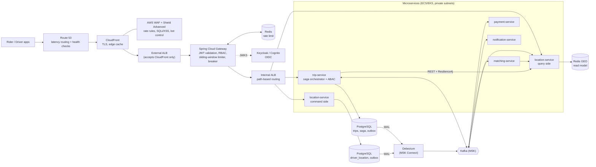
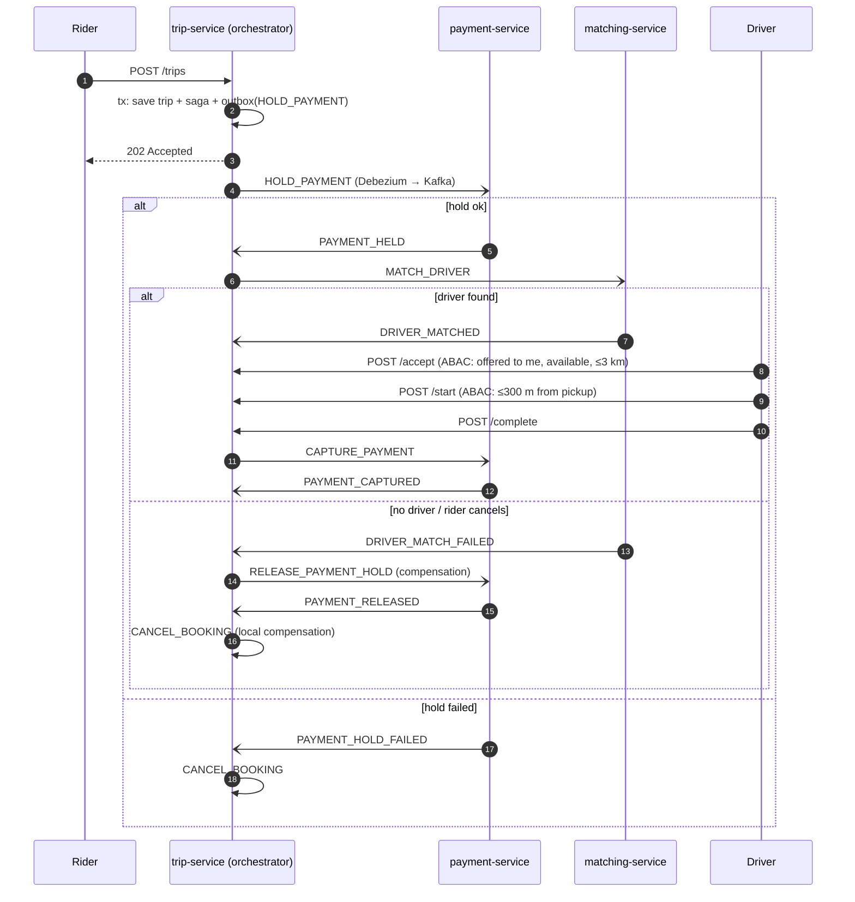

# Ride-Hailing Platform — Architecture Blueprint

Java 21 · Spring Boot 3.3 · Spring Cloud Gateway · Kafka (MSK) · PostgreSQL · Redis · Debezium · Resilience4j

## 1. High-level request flow

Edge settings:
- **Route 53**: latency/failover records with health checks on the CloudFront/ALB origin.
- **CloudFront**: only terminates TLS and caches static/config responses. All `/api/*` is `CachingDisabled` and forwards `Authorization`.
- **WAF** (attached to CloudFront): AWS managed Common + SQLi + KnownBadInputs rule groups, an IP-based rate rule (e.g. 2000 req/5 min) as the hard outer limit, and Shield Advanced for L3/L4/L7 DDoS.
- **External ALB**: SG allows only the CloudFront managed prefix list; additionally require a secret origin header injected by CloudFront.
- **Gateway** does *per-user* sliding-window limiting (finer than WAF's per-IP) and coarse RBAC. **Services** re-validate the JWT and do ABAC (zero trust).

## 2. Domain decomposition

| Service | DB | Responsibilities | Primary events (produces → consumes) |
|---|---|---|---|
| **api-gateway** | Redis (limiter) | TLS-offloaded ingress, JWT validation, RBAC by route, rate limiting, circuit-breaking, `/internal/**` blocked | – |
| **trip-service** *(implemented)* | PostgreSQL (`trips`, `saga_instance`, `outbox`) | Trip aggregate, booking saga orchestration, ABAC for trip actions, fare estimate | `TRIP_REQUESTED/DRIVER_OFFERED/DRIVER_ASSIGNED/TRIP_STARTED/TRIP_COMPLETED/TRIP_CANCELLED`, `HOLD_PAYMENT/CAPTURE_PAYMENT/RELEASE_PAYMENT_HOLD/MATCH_DRIVER/CANCEL_MATCH` → `PAYMENT_*`, `DRIVER_MATCH*` |
| **location-service** *(implemented)* | PostgreSQL (write) + Redis GEO (read) | CQRS: driver pings (command), nearest-driver search, driver context, surge | `DRIVER_LOCATION_UPDATED` → itself (projector) |
| **matching-service** *(contract only)* | PostgreSQL + Redis | Candidate selection, offer/accept/timeout loop, ranking by ETA | `DRIVER_MATCHED/DRIVER_MATCH_FAILED` → `MATCH_DRIVER`, `CANCEL_MATCH` |
| **payment-service** *(contract only)* | PostgreSQL | Wallet/PSP integration, hold → capture/release, idempotent by `id` header | `PAYMENT_HELD/HOLD_FAILED/RELEASED/CAPTURED/CAPTURE_FAILED` → `HOLD_PAYMENT`, `RELEASE_PAYMENT_HOLD`, `CAPTURE_PAYMENT` |
| **pricing-service** *(future)* | Redis/Postgres | Surge today lives in location-service query side; extract when ML forecasting arrives | `SURGE_UPDATED` |
| **notification-service** *(contract only)* | DynamoDB | Push/SMS/WhatsApp fan-out | → `outbox.event.trip` |
| **identity** | Keycloak DB / Cognito | OIDC, users, roles (`RIDER`, `DRIVER`, `ADMIN`) | – |

## 3. The booking SAGA (orchestrated)

Guarantees and decisions:
- **No dual write**: every step is one local transaction `[business update + saga update + outbox insert]`; Debezium ships the row from the WAL (`EventRouter`: topic = `outbox.event.<aggregatetype>`, key = `aggregateid`, headers `id`/`eventType`).
- **Idempotent consumers**: `processed_event` ledger keyed by the outbox row id, written in the same tx as the handler.
- **Concurrency control**: `SELECT … FOR UPDATE` on `saga_instance` serialises Kafka replies with REST actions on the same trip; stale replies are logged and ignored.
- **Pivot transaction**: once a trip is `COMPLETED` the saga only moves forward; capture failure raises `PAYMENT_CAPTURE_FAILED` for retry/dunning instead of "un-riding" the trip.
- **Invariant in the DB**: partial unique index → at most one active trip per rider, even under racing requests.

## 4. Authorization (hybrid RBAC + ABAC)

| Action | RBAC | ABAC attributes (evaluated by `TripPermissionEvaluator`) |
|---|---|---|
| VIEW | any authenticated | admin, or trip owner, or assigned driver |
| CANCEL | any authenticated | admin/owner/assigned **and** state ∈ {REQUESTED … DRIVER_ASSIGNED} |
| ACCEPT | DRIVER | trip is *offered to this driver*, state = DRIVER_OFFERED, driver status AVAILABLE/OFFERED, **within 3 km** of pickup (live location) |
| START | DRIVER | assigned, state = DRIVER_ASSIGNED, **within 300 m** of pickup |
| COMPLETE | DRIVER | assigned, state = IN_PROGRESS |

Usage: `@PreAuthorize("hasRole('DRIVER') and hasPermission(#tripId,'TRIP','ACCEPT')")`. Spring injects the `Authentication` itself, so the SpEL form is the 3-argument one; it reaches `PermissionEvaluator.hasPermission(authentication, targetId, targetType, permission)`. Fails closed (missing trip, location service down → deny).

## 5. Resilience matrix

| Call | Pattern stack | Fallback |
|---|---|---|
| gateway → services | CircuitBreaker filter + TimeLimiter (4 s); Retry only for GET | 503 `forward:/fallback/*` with `Retry-After` |
| trip → location **surge** | TimeLimiter 800 ms → Bulkhead (semaphore, 100) → CircuitBreaker | neutral multiplier 1.0 (never block booking) |
| trip → location **driver context** (ABAC) | Retry (full-jitter) → CircuitBreaker | empty ⇒ **deny** (fail closed) |
| Kafka consumers | `DefaultErrorHandler` exponential backoff → `<topic>.DLT` | poison pills dead-lettered |

Circuit breaker transitions: `CLOSED → OPEN` when ≥50 % of the last 50 calls fail (min 20) or ≥80 % are slower than 1 s; wait 20 s → `HALF_OPEN` automatically; 5 probe calls decide `CLOSED` vs back to `OPEN`.
Retry: `random(0, min(2 s, 100 ms · 2^(n-1)))` (full jitter). Never retry `CallNotPermittedException` or 4xx.

## 6. CQRS & geospatial search

- **Command**: `PUT /api/v1/drivers/me/location` → upsert in PostgreSQL + outbox row (one tx) → `202`.
- **Projection**: Kafka consumer → Redis `GEOADD geo:drivers:{type}`, hash `driver:{id}`, zset `drivers:lastseen`; out-of-order events dropped by timestamp; stale drivers evicted after 30 s.
- **Query**: `GET /internal/v1/drivers/nearby?lat&lng&radiusKm=3` → `GEOSEARCH … BYRADIUS … ASC` (successor of `GEORADIUS`), served only from Redis. Use `GEOSEARCH` with `timeout: 50ms` and same-AZ ElastiCache to stay inside 10 ms.
- Eventual consistency is intentional: ~100–300 ms CDC lag is far below the 3–4 s ping interval.

## 7. Known limitations / what to harden next

1. **Write amplification of pings through Postgres + outbox** is the first bottleneck (see `LocationCommandService` note). Move raw pings straight to Kafka, keep the outbox for business state.
2. Internal `/internal/**` APIs rely on network isolation; add mTLS or client-credentials JWTs.
3. `payment-service`, `matching-service`, `notification-service` are specified by contract only (`infra/kafka-topics.md`).
4. Offer timeout/redispatch lives in matching-service; trip-service only reacts to `DRIVER_MATCHED/FAILED`.
5. Add Testcontainers integration tests (Postgres + Kafka + Debezium) for the saga paths, plus a reconciliation job for sagas stuck in `AWAITING_*`.
6. Redis hot key → shard geo keys by city/H3 prefix at multi-city scale.
7. This code was written against Spring Boot 3.3.5 / Spring Cloud 2023.0.3 / Resilience4j 2.2.0 and has **not been compiled in this environment** (no Maven Central access). Expect to fix small API drift when you first build.
