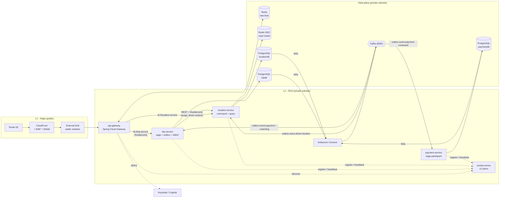
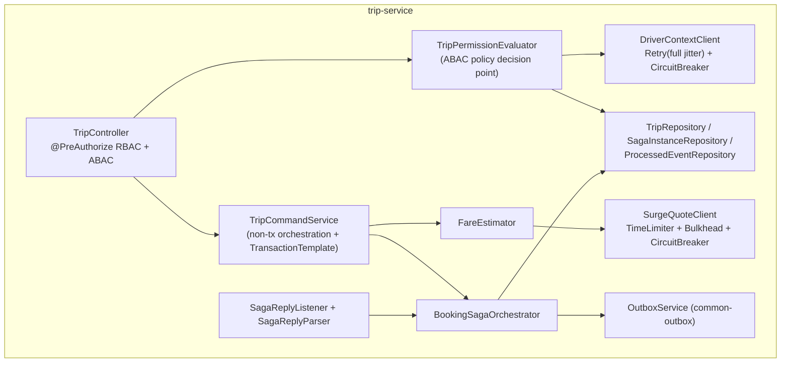
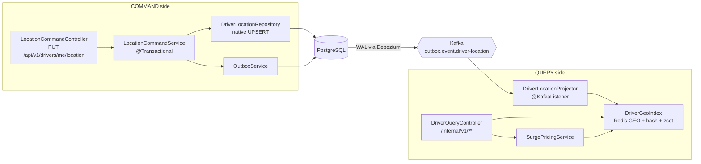
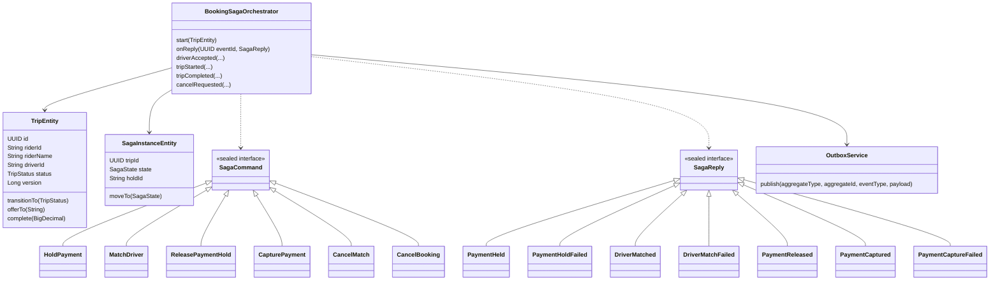
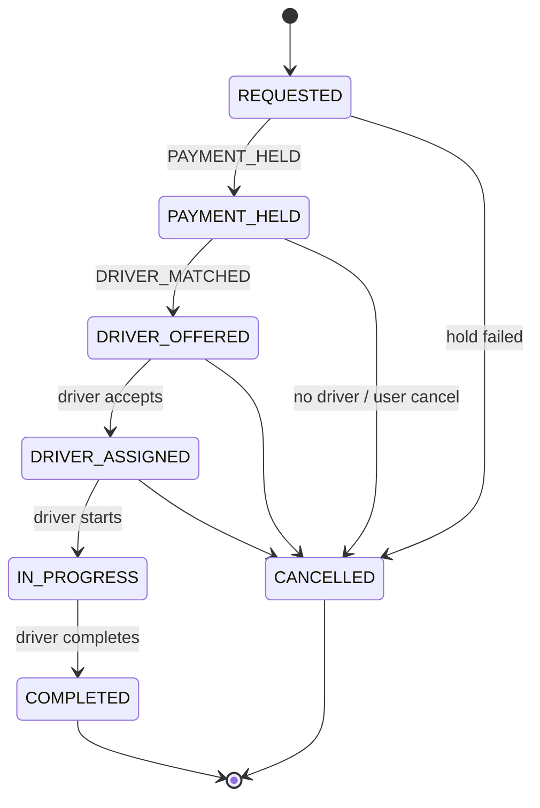
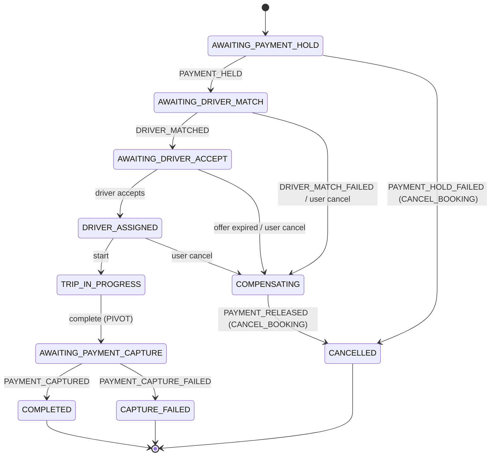
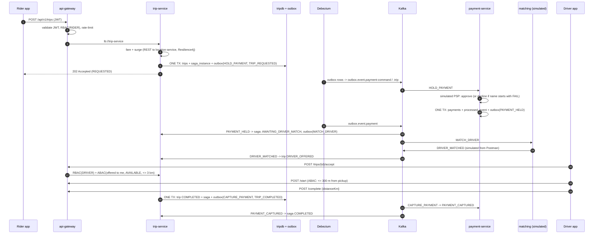

# Ridehail Platform

A Rapido/Uber-style **cab & bike-hailing backend** built as event-driven microservices on **Java 21, Spring Boot 3, Spring Cloud, Kafka, PostgreSQL, Redis and Debezium**, with the full cloud path (**Route 53 → CloudFront + WAF + Shield → ALB → API Gateway → Eureka → services**) described as **Terraform** and deployed on **Kubernetes (EKS)**.

> **How to read this README.** Sections 1–4 explain *what* the system is (HLD → LLD using the C4 model). Section 5 is the end-to-end flow. Section 6 analyses every component on six fixed dimensions. Sections 7–10 cover the edge, running locally, Terraform and Kubernetes. Section 11 is testing. Sections 12–14 are the design patterns, the Outbox-vs-CDC questions and the failure flows.

> **Honesty box – please read once.**
> * The Java code, Terraform and Kubernetes files were **written but not compiled / applied** in the authoring environment (no Maven Central / AWS access). `kubectl`-style YAML was syntax-parsed; Terraform was **not** `validate`d. Expect small fixes on first build.
> * Numbers in "Scalability & Performance Targets" and "KPIs" are **design targets**, not benchmark results.
> * `matching-service` and `notification-service` are **not implemented**; matching is simulated from Postman (Kafka REST proxy). `payment-service` **is** implemented but uses a **simulated payment gateway**.

---

## Table of contents
1. [What is implemented (and what is not)](#1-what-is-implemented-and-what-is-not)
2. [Repository layout](#2-repository-layout)
3. [HLD & LLD with the C4 model (The Four C's)](#3-hld--lld-with-the-c4-model-the-four-cs)
4. [Domain model & state machines](#4-domain-model--state-machines)
5. [End-to-end workflow](#5-end-to-end-workflow)
6. [Component deep-dives (six dimensions each)](#6-component-deep-dives-six-dimensions-each)
7. [Edge: Route 53, CloudFront, WAF, Shield Advanced, ALB](#7-edge-route-53-cloudfront-waf-shield-advanced-alb)
8. [Run it locally – step by step (startup order)](#8-run-it-locally--step-by-step-startup-order)
9. [Terraform – how it works, and why not Ansible](#9-terraform--how-it-works-and-why-not-ansible)
10. [Kubernetes – how it works, and how a beginner should read it](#10-kubernetes--how-it-works-and-how-a-beginner-should-read-it)
11. [Testing – end to end, step by step](#11-testing--end-to-end-step-by-step)
12. [Design patterns used, when they fire, and their workflow](#12-design-patterns-used-when-they-fire-and-their-workflow)
13. [Transactional Outbox vs Debezium CDC – the full Q&A](#13-transactional-outbox-vs-debezium-cdc--the-full-qa)
14. [Failure-case flows](#14-failure-case-flows)
15. [Configuration reference](#15-configuration-reference)
16. [Limitations & roadmap](#16-limitations--roadmap)

---

## 1. What is implemented (and what is not)

| Area | Status | Where |
|---|---|---|
| API gateway: JWT validation, RBAC, Redis **sliding-window** rate limit, circuit breaker, retry, fallback | ✅ | `gateway-service` |
| Service discovery + client-side load balancing | ✅ | `eureka-server`, `lb://` routes, `@LoadBalanced RestClient` |
| Trip aggregate, **orchestrated saga**, **transactional outbox**, **ABAC** | ✅ | `trip-service` |
| **CQRS** driver location (Postgres command → Debezium → Redis GEO query), surge pricing | ✅ | `location-service` |
| Saga participant with **simulated PSP**, `@RetryableTopic` + DLT | ✅ | `payment-service` |
| Shared outbox & JWT-role libraries | ✅ | `common-outbox`, `common-security` |
| Debezium outbox connectors (local + k8s templates) | ✅ | `infra/`, `k8s/base/connectors` |
| Local stack (Postgres, Redis, Kafka, Connect, Kafka REST, Keycloak) | ✅ | `infra/local` |
| Terraform: VPC, EKS, RDS, ElastiCache, MSK, ECR, Route 53, CloudFront, WAF, Shield, ALB | ✅ (unvalidated) | `infra/terraform` |
| Kubernetes manifests (Kustomize base + overlays, HPA, PDB, NetworkPolicy, Jobs) | ✅ (unapplied) | `k8s/` |
| Postman collection (103 requests) | ✅ | `postman/` |
| matching-service, notification-service | ❌ contract only (`infra/kafka-topics.md`) | – |
| MongoDB read model, Caffeine L1 cache, mesh mTLS *in code* | ❌ not used here (see mapping below) | – |

### Mapping to the reference flow you may have seen elsewhere
Many write-ups use an *order/payment* domain. This project uses a *ride-hailing* domain; the architecture is the same shape.

| Reference name | This repository |
|---|---|
| `order-command` (PostgreSQL `orders` + `outbox_events`) | **`trip-service`** (PostgreSQL `trips`, `saga_instance`, `outbox`) |
| `order-query` (MongoDB read model + Caffeine L1 + Redis L2) | **`location-service` query side** (Redis GEO + hash read model, fed by Kafka) |
| `payment` consuming `payment-events` with `@RetryableTopic`, DLT `payment-events.DLT` | **`payment-service`** consuming `outbox.event.payment-command`; DLT `outbox.event.payment-command.DLT` |
| `payment-results` → `order-command` | `outbox.event.payment` → trip-service saga |
| Kafka topics `order-events`, `payment-events` | `outbox.event.<aggregatetype>` (e.g. `outbox.event.trip`, `outbox.event.payment`) |
| Passenger name `FAIL…` ⇒ payment declined ⇒ SAGA compensation | JWT `preferred_username` starting with **`FAIL`** ⇒ hold declined ⇒ saga compensation (see §14) |
| mTLS gateway → services | Provided by an **optional service mesh** (`k8s/mesh/istio-mtls.yaml`), not by Java code |

---

## 2. Repository layout

```
ridehail-platform/
├── pom.xml                         parent POM (Spring Boot 3.3.5, Spring Cloud 2023.0.3, Resilience4j 2.2.0)
├── Dockerfile                      one multi-stage Dockerfile for every service (--build-arg MODULE=...)
├── common-outbox/                  shared library: OutboxEntity / OutboxService / purge job
├── common-security/                shared library: JWT -> ROLE_* converter (Keycloak + Cognito)
├── eureka-server/                  service registry                                   :8761
├── gateway-service/                Spring Cloud Gateway                                :8080
├── trip-service/                   trips + booking saga + ABAC                         :8081
├── location-service/               driver location CQRS + surge                        :8082
├── payment-service/                saga participant (simulated PSP)                    :8084
├── infra/
│   ├── debezium-*.json             connector configs (prod-style)
│   ├── kafka-topics.md             topic + command/reply contract
│   ├── local/                      docker-compose, Keycloak realm, local connectors, helper scripts
│   └── terraform/                  AWS infrastructure (root + modules/)
├── k8s/                            Kubernetes manifests (base/, overlays/, mesh/)
├── postman/                        collection, environment, TESTING_GUIDE.md
└── ARCHITECTURE.md                 shorter architecture blueprint
```

---

## 3. HLD & LLD with the C4 model (The Four C's)

The **C4 model** describes software at four zoom levels: **C**ontext → **C**ontainers → **C**omponents → **C**ode. Levels 1–2 are the **High-Level Design (HLD)**; levels 3–4 are the **Low-Level Design (LLD)**.

| Level | Question it answers | Audience | Section |
|---|---|---|---|
| **C1 Context** | Who uses the system and what other systems does it touch? | Everyone | 3.1 |
| **C2 Container** | What deployable units/data stores exist and how do they talk? | Architects, devs, ops | 3.2 |
| **C3 Component** | What are the major building blocks *inside* one container? | Developers | 3.3 |
| **C4 Code** | Which classes/interfaces implement a component? | Developers | 3.4 |

### 3.1 C1 – System Context (HLD)


### 3.2 C2 – Container view (HLD)



### 3.3 C3 – Component view (LLD)

**trip-service**



**location-service (CQRS)**



### 3.4 C4 – Code view (LLD)

Key classes and their relationships (trip-service):



Java 21 features in the code: **sealed interfaces + records** (`SagaCommand`, `SagaReply`, `TripEvent` – exhaustive `switch` with pattern matching, the compiler forces every reply to be handled), **virtual threads** (`spring.threads.virtual.enabled=true` and `Executors.newVirtualThreadPerTaskExecutor()` in `VirtualThreadConfig`), text blocks (Lua script, SQL).

---

## 4. Domain model & state machines

**Trip status** (`TripStatus.canTransitionTo` rejects illegal moves inside the aggregate):



**Saga state** (`saga_instance.state`, persisted so the workflow survives restarts):



**Fare**: `(base + perKm × km) × surge` – BIKE 20 + 6/km, AUTO 30 + 11/km, CAB 50 + 14/km; estimated km = straight line × 1.3; surge ∈ [1.0, 3.0].

**Kafka topics** (`outbox.event.<aggregatetype>`; Debezium EventRouter names them):

| Topic | Produced by | Key | Consumed by |
|---|---|---|---|
| `outbox.event.trip` | trip-service | tripId | notification (future), analytics |
| `outbox.event.payment-command` | trip-service (saga commands) | tripId | payment-service |
| `outbox.event.matching-command` | trip-service (saga commands) | tripId | matching-service (simulated) |
| `outbox.event.payment` | payment-service | tripId | trip-service saga |
| `outbox.event.matching` | matching-service (simulated) | tripId | trip-service saga |
| `outbox.event.driver-location` | location-service | driverId | location-service projector |
| `<topic>.DLT`, `outbox.event.payment-command-retry-<delay>` | frameworks | – | operators |

---

## 5. End-to-end workflow

### 5.1 Request path (infrastructure view)

```
Route 53 (api.example.com, alias A/AAAA + health check)
   -> CloudFront (TLS 1.2+, no caching for the API)  + AWS WAF (managed rules + rate rule)  + Shield (Std/Advanced)
        -> HTTPS + secret header X-Origin-Verify
   -> External ALB  (L1, PUBLIC subnets, accepts only CloudFront IP ranges, forwards only if the secret header matches)
        -> target group (type ip)  <- TargetGroupBinding registers api-gateway POD IPs
   -> api-gateway  (JWT check, RBAC, Redis sliding-window rate limit, circuit breaker)
        -> Eureka lookup + client-side load balancing (Spring Cloud LoadBalancer)  [+ mTLS if the mesh is enabled]
   -> trip-service / location-service / (payment-service has no REST API)   (L2, PRIVATE subnets)
```

### 5.2 Data and event flow

```
trip-service      -> PostgreSQL (trips + saga_instance + outbox)   --one local transaction-->
                  -> Debezium (reads WAL) -> Kafka outbox.event.payment-command | .matching-command | .trip

payment-service   <- Kafka outbox.event.payment-command  (@RetryableTopic: retry topics, DLT outbox.event.payment-command.DLT)
                  -> PostgreSQL (payments + outbox)  -> Debezium -> Kafka outbox.event.payment
trip-service      <- Kafka outbox.event.payment / outbox.event.matching  -> saga advances / compensates

location-service  command: PUT location -> PostgreSQL (driver_location + outbox) -> Debezium -> Kafka outbox.event.driver-location
                  query  : Kafka -> projector -> Redis GEO (+hash,+zset) -> GET /internal/v1/drivers/nearby (sub-10 ms target)
trip-service      -> REST (Eureka lb) -> location-service  (surge quote, driver context for ABAC)  [Resilience4j]
```

### 5.3 The happy path, message by message



Failure branches are in [§14](#14-failure-case-flows).

---

## 6. Component deep-dives (six dimensions each)

Each component is analysed on the same six dimensions: **(1)** purpose & responsibilities, **(2)** KPIs, **(3)** data flow / response times / failure impact, **(4)** technologies, advantages, limitations, **(5)** scalability & performance targets, **(6)** security, reliability & compliance. All numeric values are **design targets** unless they are configuration values visible in the code (those are marked *(config)*).

### 6.1 api-gateway (`gateway-service`, port 8080)

**1. Primary purpose & key responsibilities**
* Single public entry point behind the ALB; hides internal topology.
* Validates the JWT (signature, issuer, expiry) and applies **coarse RBAC** per route (`POST /api/v1/trips` → RIDER, `/api/v1/drivers/**` → DRIVER, `/internal/**` → denied for everyone).
* Per-user **sliding-window rate limiting** in Redis (20 req/10 s trips, 10 req/10 s driver location *(config)*).
* Resolves `lb://trip-service` / `lb://location-service` through Eureka and load-balances client-side.
* Applies a **circuit breaker + timeout** per route; retries only idempotent GETs; returns a clean 503 + `Retry-After` via `FallbackController`.
* Strips client-supplied identity headers (`X-User-Id`, `X-User-Roles`).

**2. Measuring success (KPIs)**
* Availability ≥ 99.95 %; added gateway latency p99 ≤ 15 ms.
* % requests rejected by the limiter (429) vs. abusive-traffic estimate; false-positive rate ≈ 0 for normal users.
* Circuit-breaker open-time per route; fallback (503) rate < 0.1 % in steady state.
* 401/403 ratio (spike ⇒ token/clock/config problem or attack).
* Metrics: `http_server_requests_seconds`, `spring_cloud_gateway_requests_seconds`, `resilience4j_circuitbreaker_state` (Prometheus endpoint enabled).

**3. Data flow, response times & failure impact**
* Flow: ALB → JWT filter → rate-limit filter (1 Redis round-trip, Lua) → CircuitBreaker filter → Retry filter (GET) → `lb://` call.
* Overhead target: ≤ 5 ms Redis + ≤ 5 ms filters; timeout 4 s per route *(config)*, connect 1 s, response 5 s.
* **Gateway down** ⇒ whole platform unreachable (mitigation: ≥ 3 replicas across AZs, PDB `minAvailable: 2`, HPA).
* **Redis down** ⇒ limiter **fails open** (logged); WAF's per-IP rule remains the outer limit.
* **A backend down** ⇒ breaker opens after 20+ calls at ≥ 50 % failures; clients get 503 fast instead of hanging.
* **Eureka down** ⇒ gateway keeps using its cached registry (refreshes every 10 s); new instances are not discovered until Eureka returns.

**4. Technologies, advantages, limitations**
* Spring Cloud Gateway (reactive/Netty), Spring Security OAuth2 Resource Server, Redis (Lua), Resilience4j, Eureka client + Spring Cloud LoadBalancer.
* ✔ Non-blocking, filter model is easy to extend, route config is plain YAML.
* ✘ Reactive programming model has a learning curve; stateful limiter depends on Redis; Spring's own limiter is token-bucket, so we wrote a custom sliding-window limiter (more Redis memory: one ZSET entry per request in the window).

**5. Scalability & performance targets**
* Stateless ⇒ horizontal scaling (HPA 3→10 pods at 60 % CPU *(k8s/base/30-hpa.yaml)*).
* Target: 5 k req/s per pod, 50 k req/s cluster; 20 ms p99 end-to-end for pass-through routes.
* Redis limiter cost: O(log N) per request; N ≤ limit (20) so effectively constant.

**6. Security, reliability & compliance**
* TLS terminated at CloudFront/ALB; JWT re-validated by every downstream service (zero trust); `/internal/**` never routed.
* WAF + Shield in front; ALB accepts only CloudFront IPs + secret header.
* Graceful shutdown (`server.shutdown=graceful`), readiness/liveness probes, preStop sleep so ALB/Eureka deregister before SIGTERM.
* No PII stored; logs must not contain tokens (OWASP A09). Compliance mapping: PCI-DSS scope is **only** at the PSP (card data never enters this system).

### 6.2 eureka-server (port 8761)

**1. Purpose & responsibilities**
* Service registry: services register (`spring.application.name`), heartbeat every 10 s, evicted after 30 s *(config)*.
* Gives the gateway and trip-service a live instance list for client-side load balancing.

**2. KPIs**
* Registry availability ≥ 99.9 %; registration propagation ≤ 10 s; stale-instance rate (calls to dead instances) < 0.1 %; peer replication lag ≈ seconds.

**3. Data flow, response times & failure impact**
* Clients fetch the full registry every 10 s *(config)* and cache it ⇒ lookups are local (0 ms network).
* **Eureka down**: running services keep working from cache; no new registrations, no eviction; **self-preservation** stops mass-eviction during network partitions.
* Impact of a bad eviction: traffic to a healthy instance stops (reduce by tuning lease/renewal).

**4. Technologies, advantages, limitations**
* Spring Cloud Netflix Eureka. ✔ AP-style (available under partition), simple, no extra infra locally.
* ✘ Eventually consistent registry; Kubernetes already has Service DNS (so Eureka is redundant on k8s – kept here because the project requires client-side LB + local-dev parity); no built-in auth (put it behind NetworkPolicy/mesh).

**5. Scalability & performance targets**
* 2 peers (StatefulSet) handle hundreds of instances; 3 for prod HA. Memory ≈ 512 Mi.

**6. Security, reliability & compliance**
* Not internet-exposed (ClusterIP/headless). Add Spring Security basic auth or mTLS before production. HA via peer replication (`EUREKA_PEER_MODE=true`).

### 6.3 trip-service (port 8081)

**1. Purpose & responsibilities**
* Owns the **trip aggregate** and its state machine; exposes booking/accept/start/complete/cancel/get.
* **Orchestrates the booking saga** (hold payment → match driver → accept → start → complete → capture) with compensations.
* **Transactional outbox** for every state change/command; idempotent saga-reply consumer.
* **ABAC** policy decision point (`TripPermissionEvaluator`).
* Computes fare estimate (distance + surge from location-service).

**2. KPIs**
* Booking acceptance latency p99 ≤ 300 ms (target); booking→driver-offered p95 ≤ 5 s.
* Saga success rate ≥ 97 %; compensation rate and **stuck-saga count** (saga in `AWAITING_*` > 2 min) = 0.
* Outbox lag (rows not yet relayed) < 1 s; consumer lag on `outbox.event.payment|matching` < 100 msgs; DLT depth = 0.
* Circuit-breaker states for `surgeQuote` / `driverContext`; ABAC denial reasons.

**3. Data flow, response times & failure impact**
* `POST /trips`: fare lookup (≤ 800 ms time-limited, **outside** any DB transaction) → 1 DB transaction (trip + saga + 2 outbox rows) → 202. Typical 30–80 ms excluding surge call.
* Replies arrive via Kafka; each reply = 1 DB transaction with `SELECT … FOR UPDATE` on the saga row.
* **location-service down** ⇒ surge falls back to 1.0× (booking continues) but ABAC for accept/start **fails closed** (403).
* **Kafka/Debezium down** ⇒ API still works (writes to DB + outbox); events accumulate in WAL/outbox and flow when Debezium recovers (no loss, delayed progress).
* **PostgreSQL down** ⇒ writes fail (503); reads fail; Kubernetes restarts pods only if probes fail.
* **payment-service down** ⇒ trips pile up in `REQUESTED`; commands wait in Kafka; resume on recovery.

**4. Technologies, advantages, limitations**
* Java 21 (sealed types, records, virtual threads), Spring Boot 3 / Data JPA / Security / Kafka, PostgreSQL + Flyway, Resilience4j.
* ✔ Strong consistency inside a service, atomic DB+event publish, exhaustive compile-time handling of saga messages.
* ✘ Orchestrator is a coordination point (needs care to avoid becoming a "god service"); saga state machine must be maintained when steps change; pessimistic lock per trip serialises events for the *same* trip (fine – different trips are independent); eventual consistency visible to clients (poll or push).

**5. Scalability & performance targets**
* Stateless pods, scale 3→10 (HPA). Partition key = tripId ⇒ per-trip ordering with parallelism across trips.
* Target 1 k bookings/s cluster; Hikari pool 30 *(config)* is the real concurrency limit with virtual threads.
* DB: single-writer Postgres per service; scale up/read-replicas; shard by city when > 10 k writes/s.

**6. Security, reliability & compliance**
* JWT re-validated; RBAC (`hasRole`) + ABAC (`hasPermission`) on every endpoint; unknown trip ⇒ 403 (no id probing); fail-closed on dependency loss.
* Optimistic (`@Version`) + pessimistic locking; idempotent consumer ledger; partial unique index "one active trip per rider".
* Data minimisation: stores user id + user name (JWT `preferred_username`), **no card data**; audit trail = outbox/event history. GDPR/DPDP: tie `riderId` deletion to an anonymisation job (roadmap).

### 6.4 location-service (port 8082) – command + query (CQRS)

**1. Purpose & responsibilities**
* **Command side**: accept driver location pings, upsert the latest position in PostgreSQL and write an outbox event in the same transaction.
* **Query side**: maintain a Redis GEO read model from Kafka; answer "drivers within N km" (`GEOSEARCH`), driver context (for ABAC) and surge quotes.
* Evict drivers that stop pinging (30 s) and keep only AVAILABLE drivers searchable.

**2. KPIs**
* Nearby query p99 ≤ 10 ms server-side (Redis `GEOSEARCH`; client timeout 50 ms *(config)*).
* Read-model freshness (ping → searchable) p95 ≤ 1 s; projector consumer lag ≈ 0; stale-driver ratio < 1 %.
* Write throughput sustained (pings/s) vs. target; outbox purge keeps table < 1 M rows.

**3. Data flow, response times & failure impact**
* Write: `PUT` → 1 DB tx (upsert + outbox) → 202 (≈ 5–15 ms). Read: Redis only (never touches Postgres).
* **Redis down** ⇒ queries fail fast (50 ms timeout) → trip-service falls back (surge) / fails closed (ABAC); projector retries then DLT.
* **Debezium/Kafka down** ⇒ writes continue, read model goes stale (drivers eventually evicted after 30 s ⇒ "no drivers" rather than wrong drivers).
* **Redis flushed** ⇒ rebuild by replaying `driver_location` table or the topic (roadmap job).

**4. Technologies, advantages, limitations**
* Spring Web/JPA, PostgreSQL, Kafka, Redis GEO (GEOSEARCH), Debezium.
* ✔ Independent scaling of reads and writes; very fast geospatial lookup; schema-free read model.
* ✘ **Eventual consistency**; each ping writes Postgres + outbox (≈ 2 inserts + WAL) → write amplification at very high scale (mitigation noted in §16); one geo key per vehicle type is a hot key (shard by city/H3 cell at scale).

**5. Scalability & performance targets**
* Target 25 k pings/s (100 k drivers / 4 s) – requires batching or direct-to-Kafka for raw pings; read path ≥ 20 k queries/s per Redis primary.
* HPA 3→15 pods.

**6. Security, reliability & compliance**
* Driver identity comes from the **JWT subject**, never the body ⇒ a driver can only move their own pin. `/internal/**` is closed at the gateway and (on k8s) restricted by NetworkPolicy.
* Location is **personal data**: retention limit on `driver_location` (latest only), no history stored here; encrypt at rest (RDS/ElastiCache); purpose limitation (matching/ETA only).
* Out-of-order events are dropped by timestamp; projector is idempotent (GEOADD overwrite).

### 6.5 payment-service (port 8084)

**1. Purpose & responsibilities**
* Saga **participant**: executes `HOLD_PAYMENT`, `CAPTURE_PAYMENT`, `RELEASE_PAYMENT_HOLD` and answers `PAYMENT_HELD | PAYMENT_HOLD_FAILED | PAYMENT_RELEASED | PAYMENT_CAPTURED | PAYMENT_CAPTURE_FAILED` via **its own outbox**.
* Simulated PSP: name `FAIL…` ⇒ hold declined; name `CAPFAIL…` ⇒ capture rejected.

**2. KPIs**
* Authorisation success rate; decline rate by reason; capture success rate; command→reply latency p95 ≤ 1 s (excl. Debezium lag).
* Retry-topic depth, **DLT message count = 0**, duplicate-command ratio.

**3. Data flow, response times & failure impact**
* `outbox.event.payment-command` → listener → 1 DB tx (ledger + payment + outbox reply) → Debezium → `outbox.event.payment`.
* Transient failure ⇒ **non-blocking retries** on retry topics (1 s, 2 s, 4 s) then `…payment-command.DLT`; malformed payloads go straight to DLT.
* **Service down** ⇒ commands wait in Kafka (no loss); saga stays in `AWAITING_PAYMENT_HOLD`.
* **Duplicate command** ⇒ ignored via `processed_event`; **capture failure** ⇒ forward recovery (not compensation).

**4. Technologies, advantages, limitations**
* Spring Kafka `@RetryableTopic`/`@DltHandler`, JPA, Flyway, common-outbox.
* ✔ Retries never block a partition; independent DB. ✘ Retry/DLT topics multiply topic count; the PSP is a stub (no real network call, no webhooks, no refunds).

**5. Scalability & performance targets**
* Concurrency = topic partitions (3 listeners per pod); 2→6 pods; target 500 payments/s.

**6. Security, reliability & compliance**
* No public API (Kafka only); **no PAN/card data** – use PSP tokens; idempotent by `tripId` + event id; PCI-DSS SAQ-A style scope if a hosted PSP is used.
* Secrets (DB creds, PSP keys) via Secrets Manager / External Secrets, never in git.

### 6.6 Data & messaging backbone (PostgreSQL, Debezium, Kafka, Redis)

**1. Purpose** – PostgreSQL per service (database-per-service), **Debezium** streams the WAL outbox rows to **Kafka**, **Redis** serves rate-limit state and the geo read model.
**2. KPIs** – Debezium `MilliSecondsBehindSource` < 500 ms; replication-slot lag/retained WAL size; Kafka under-replicated partitions = 0; consumer-group lag; Redis hit/latency.
**3. Flow & failure** – DB commit → WAL → Connect → topic. *Connect down*: WAL retained by the replication slot (**watch disk**), events delayed not lost. *Broker loss*: RF 3 / `min.insync.replicas=2` keeps writes. *Redis failover*: ElastiCache Multi-AZ.
**4. Tech/limits** – Debezium needs `wal_level=logical` and replication slots (monitor to avoid WAL bloat); Kafka adds operational weight; Redis is in-memory (size for ZSET/GEO).
**5. Targets** – MSK 3 brokers, 6 partitions/topic (48 for driver-location), RF 3; Postgres `db.t4g.medium`→larger; Redis 2 nodes/group.
**6. Security** – all in private subnets; SG allows only EKS nodes; RDS/ElastiCache/MSK encrypted at rest and in transit (MSK TLS); credentials generated by RDS and stored in Secrets Manager (`manage_master_user_password`); PITR backups 7 days.

### 6.7 matching-service & notification-service (not implemented)
* **matching-service** would consume `MATCH_DRIVER`, call `GET /internal/v1/drivers/nearby`, run the offer/accept/timeout loop and reply `DRIVER_MATCHED | DRIVER_MATCH_FAILED` through its outbox. Today Postman produces those replies.
* **notification-service** would consume `outbox.event.trip` (e.g. `DRIVER_OFFERED`, `TRIP_COMPLETED`) to send push/SMS.
* Contract: [`infra/kafka-topics.md`](infra/kafka-topics.md).

### 6.8 Shared libraries
* **common-outbox** – `OutboxEntity` (Debezium-compatible columns), `OutboxService` (**`Propagation.MANDATORY`** – refuses to run outside a transaction), `OutboxPurgeJob` (deletes rows older than 1 h; safe because Debezium reads WAL inserts).
* **common-security** – `JwtRoleConverter` maps Keycloak `realm_access.roles` and Cognito `cognito:groups` to `ROLE_*`.

---
