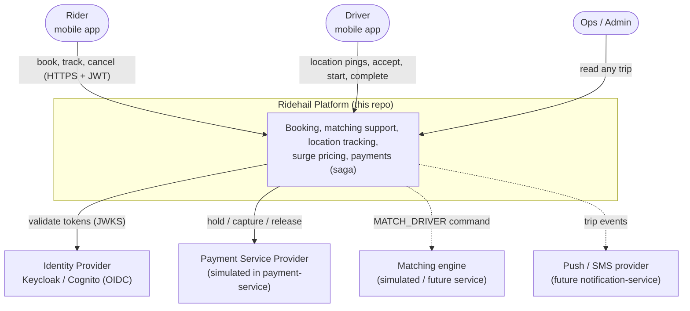
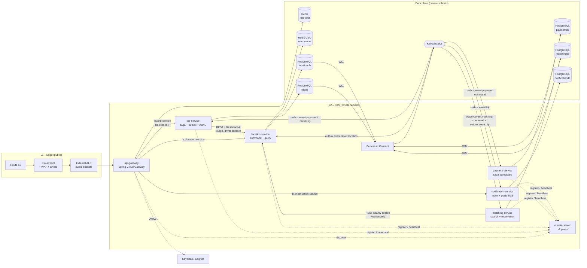
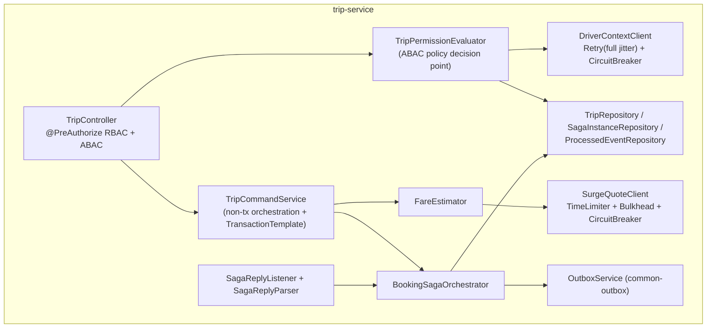
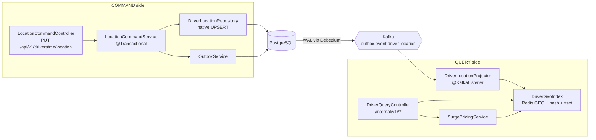
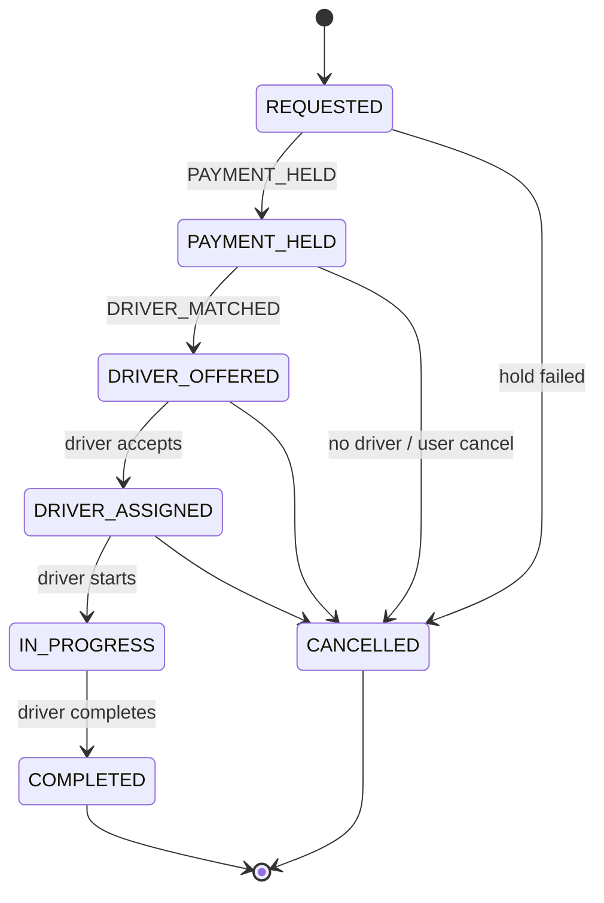
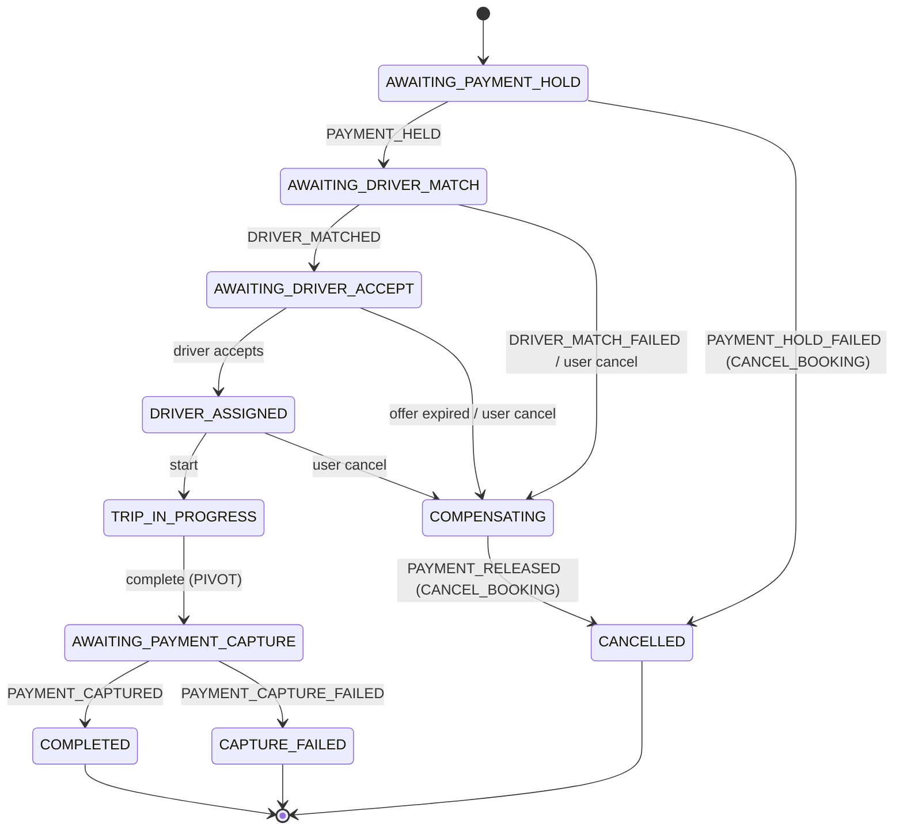
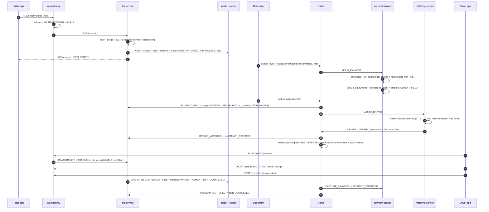
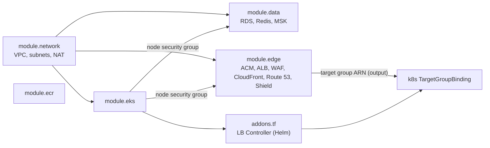
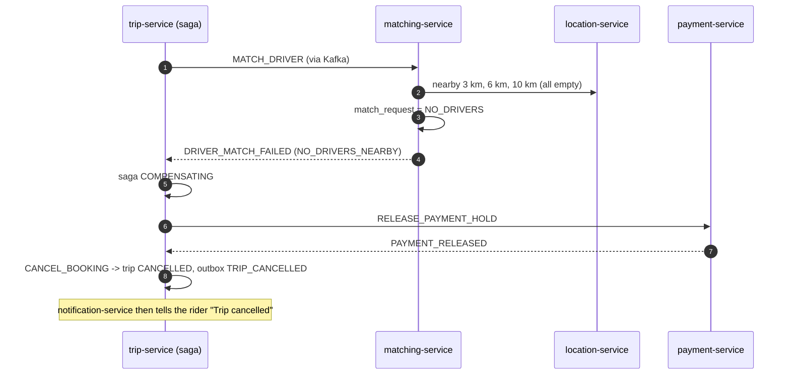

# Ridehail Platform

A Rapido/Uber-style **cab & bike-hailing backend** built as event-driven microservices on **Java 21, Spring Boot 3, Spring Cloud, Kafka, PostgreSQL, Redis and Debezium**, with the full cloud path (**Route 53 → CloudFront + WAF + Shield → ALB → API Gateway → Eureka → services**) described as **Terraform** and deployed on **Kubernetes (EKS)**.

> **How to read this README.** Sections 1–4 explain *what* the system is (HLD → LLD using the C4 model). Section 5 is the end-to-end flow. Section 6 analyses every component on six fixed dimensions. Sections 7–10 cover the edge, running locally, Terraform and Kubernetes. Section 11 is testing. Sections 12–14 are the design patterns, the Outbox-vs-CDC questions and the failure flows.

> **Honesty box – please read once.**
> * The Java code, Terraform and Kubernetes files were **written but not compiled / applied** in the authoring environment (no Maven Central / AWS access). `kubectl`-style YAML was syntax-parsed; Terraform was **not** `validate`d. Expect small fixes on first build.
> * Numbers in "Scalability & Performance Targets" and "KPIs" are **design targets**, not benchmark results.
> * All services now exist: `payment-service` uses a **simulated payment gateway**, `notification-service` uses **simulated push/SMS providers**, and `matching-service` does a real driver search but a simple greedy (nearest-free-driver) assignment.

---

## Table of contents
1. [What is implemented (and what is not)](#1-what-is-implemented-and-what-is-not)
2. [Repository layout](#2-repository-layout)
3. [HLD & LLD with the C4 model (The Four C's)](#3-hld--lld-with-the-c4-model-the-four-cs)
4. [Domain model & state machines](#4-domain-model--state-machines)
5. [End-to-end workflow](#5-end-to-end-workflow)
6. [Component deep-dives (six dimensions each)](#6-component-deep-dives-six-dimensions-each)
7. [Edge: Route 53, CloudFront, WAF, Shield Advanced, ALB](#7-edge-route-53-cloudfront-waf-shield-advanced-alb)
8. [Run it locally – step by step (startup order)](#8-run-it-locally--step-by-step-startup-order)
9. [Terraform – how it works, and why not Ansible](#9-terraform--how-it-works-and-why-not-ansible)
10. [Kubernetes – how it works, and how a beginner should read it](#10-kubernetes--how-it-works-and-how-a-beginner-should-read-it)
11. [Testing – end to end, step by step](#11-testing--end-to-end-step-by-step)
12. [Design patterns used, when they fire, and their workflow](#12-design-patterns-used-when-they-fire-and-their-workflow)
13. [Transactional Outbox vs Debezium CDC – the full Q&A](#13-transactional-outbox-vs-debezium-cdc--the-full-qa)
14. [Failure-case flows](#14-failure-case-flows)
15. [Configuration reference](#15-configuration-reference)
16. [Limitations & roadmap](#16-limitations--roadmap)

---

## 1. What is implemented (and what is not)

| Area | Status | Where |
|---|---|---|
| API gateway: JWT validation, RBAC, Redis **sliding-window** rate limit, circuit breaker, retry, fallback | ✅ | `gateway-service` |
| Service discovery + client-side load balancing | ✅ | `eureka-server`, `lb://` routes, `@LoadBalanced RestClient` |
| Trip aggregate, **orchestrated saga**, **transactional outbox**, **ABAC** | ✅ | `trip-service` |
| **CQRS** driver location (Postgres command → Debezium → Redis GEO query), surge pricing | ✅ | `location-service` |
| Saga participant with **simulated PSP**, `@RetryableTopic` + DLT | ✅ | `payment-service` |
| Shared outbox & JWT-role libraries | ✅ | `common-outbox`, `common-security` |
| Debezium outbox connectors (local + k8s templates) | ✅ | `infra/`, `k8s/base/connectors` |
| Local stack (Postgres, Redis, Kafka, Connect, Kafka REST, Keycloak) | ✅ | `infra/local` |
| Terraform: VPC, EKS, RDS, ElastiCache, MSK, ECR, Route 53, CloudFront, WAF, Shield, ALB | ✅ (unvalidated) | `infra/terraform` |
| Kubernetes manifests (Kustomize base + overlays, HPA, PDB, NetworkPolicy, Jobs) | ✅ (unapplied) | `k8s/` |
| **matching-service**: radius-expanding driver search, driver reservation, offer timeout | ✅ | `matching-service` |
| **notification-service**: in-app inbox API + simulated push/SMS, participant read model | ✅ | `notification-service` |
| MongoDB read model, Caffeine L1 cache, mesh mTLS *in code* | ❌ not used here (see mapping below) | – |
| Postman collection (123 requests, 3 test modes) | ✅ | `postman/` |

### Mapping to the reference flow you may have seen elsewhere
Many write-ups use an *order/payment* domain. This project uses a *ride-hailing* domain; the architecture is the same shape.

| Reference name | This repository |
|---|---|
| `order-command` (PostgreSQL `orders` + `outbox_events`) | **`trip-service`** (PostgreSQL `trips`, `saga_instance`, `outbox`) |
| `order-query` (MongoDB read model + Caffeine L1 + Redis L2) | **`location-service` query side** (Redis GEO + hash read model, fed by Kafka) |
| `payment` consuming `payment-events` with `@RetryableTopic`, DLT `payment-events.DLT` | **`payment-service`** consuming `outbox.event.payment-command`; DLT `outbox.event.payment-command.DLT` |
| `payment-results` → `order-command` | `outbox.event.payment` → trip-service saga |
| Kafka topics `order-events`, `payment-events` | `outbox.event.<aggregatetype>` (e.g. `outbox.event.trip`, `outbox.event.payment`) |
| Passenger name `FAIL…` ⇒ payment declined ⇒ SAGA compensation | JWT `preferred_username` starting with **`FAIL`** ⇒ hold declined ⇒ saga compensation (see §14) |
| mTLS gateway → services | Provided by an **optional service mesh** (`k8s/mesh/istio-mtls.yaml`), not by Java code |

---

## 2. Repository layout

```
ridehail-platform/
├── pom.xml                         parent POM (Spring Boot 3.3.5, Spring Cloud 2023.0.3, Resilience4j 2.2.0)
├── Dockerfile                      one multi-stage Dockerfile for every service (--build-arg MODULE=...)
├── common-outbox/                  shared library: OutboxEntity / OutboxService / purge job
├── common-security/                shared library: JWT -> ROLE_* converter (Keycloak + Cognito)
├── eureka-server/                  service registry                                   :8761
├── gateway-service/                Spring Cloud Gateway                                :8080
├── trip-service/                   trips + booking saga + ABAC                         :8081
├── location-service/               driver location CQRS + surge                        :8082
├── payment-service/                saga participant (simulated PSP)                    :8084
├── matching-service/               saga participant: driver search + reservation       :8085
├── notification-service/           trip events -> inbox / push / SMS + inbox API       :8086
├── infra/
│   ├── debezium-*.json             connector configs (prod-style)
│   ├── kafka-topics.md             topic + command/reply contract
│   ├── local/                      docker-compose, Keycloak realm, local connectors, helper scripts
│   └── terraform/                  AWS infrastructure (root + modules/)
├── k8s/                            Kubernetes manifests (base/, overlays/, mesh/)
├── postman/                        collection, environment, TESTING_GUIDE.md
└── ARCHITECTURE.md                 shorter architecture blueprint
```

---

## 3. HLD & LLD with the C4 model (The Four C's)

The **C4 model** describes software at four zoom levels: **C**ontext → **C**ontainers → **C**omponents → **C**ode. Levels 1–2 are the **High-Level Design (HLD)**; levels 3–4 are the **Low-Level Design (LLD)**.

| Level | Question it answers | Audience | Section |
|---|---|---|---|
| **C1 Context** | Who uses the system and what other systems does it touch? | Everyone | 3.1 |
| **C2 Container** | What deployable units/data stores exist and how do they talk? | Architects, devs, ops | 3.2 |
| **C3 Component** | What are the major building blocks *inside* one container? | Developers | 3.3 |
| **C4 Code** | Which classes/interfaces implement a component? | Developers | 3.4 |

### 3.1 C1 – System Context (HLD)



### 3.2 C2 – Container view (HLD)



### 3.3 C3 – Component view (LLD)

**trip-service**



**location-service (CQRS)**



### 3.4 C4 – Code view (LLD)

Key classes and their relationships (trip-service):


Java 21 features in the code: **sealed interfaces + records** (`SagaCommand`, `SagaReply`, `TripEvent` – exhaustive `switch` with pattern matching, the compiler forces every reply to be handled), **virtual threads** (`spring.threads.virtual.enabled=true` and `Executors.newVirtualThreadPerTaskExecutor()` in `VirtualThreadConfig`), text blocks (Lua script, SQL).

---

## 4. Domain model & state machines

**Trip status** (`TripStatus.canTransitionTo` rejects illegal moves inside the aggregate):



**Saga state** (`saga_instance.state`, persisted so the workflow survives restarts):



**Fare**: `(base + perKm × km) × surge` – BIKE 20 + 6/km, AUTO 30 + 11/km, CAB 50 + 14/km; estimated km = straight line × 1.3; surge ∈ [1.0, 3.0].

**Kafka topics** (`outbox.event.<aggregatetype>`; Debezium EventRouter names them):

| Topic | Produced by | Key | Consumed by |
|---|---|---|---|
| `outbox.event.trip` | trip-service | tripId | **notification-service**, **matching-service** (reservation lifecycle), analytics |
| `outbox.event.payment-command` | trip-service (saga commands) | tripId | payment-service |
| `outbox.event.matching-command` | trip-service (saga commands) | tripId | matching-service |
| `outbox.event.payment` | payment-service | tripId | trip-service saga |
| `outbox.event.matching` | matching-service | tripId | trip-service saga |
| `outbox.event.driver-location` | location-service | driverId | location-service projector |
| `<topic>.DLT`, `outbox.event.payment-command-retry-<delay>` | frameworks | – | operators |

---

## 5. End-to-end workflow

### 5.1 Request path (infrastructure view)

```
Route 53 (api.example.com, alias A/AAAA + health check)
   -> CloudFront (TLS 1.2+, no caching for the API)  + AWS WAF (managed rules + rate rule)  + Shield (Std/Advanced)
        -> HTTPS + secret header X-Origin-Verify
   -> External ALB  (L1, PUBLIC subnets, accepts only CloudFront IP ranges, forwards only if the secret header matches)
        -> target group (type ip)  <- TargetGroupBinding registers api-gateway POD IPs
   -> api-gateway  (JWT check, RBAC, Redis sliding-window rate limit, circuit breaker)
        -> Eureka lookup + client-side load balancing (Spring Cloud LoadBalancer)  [+ mTLS if the mesh is enabled]
   -> trip-service / location-service / (payment-service has no REST API)   (L2, PRIVATE subnets)
```

### 5.2 Data and event flow

```
trip-service      -> PostgreSQL (trips + saga_instance + outbox)   --one local transaction-->
                  -> Debezium (reads WAL) -> Kafka outbox.event.payment-command | .matching-command | .trip

payment-service   <- Kafka outbox.event.payment-command  (@RetryableTopic: retry topics, DLT outbox.event.payment-command.DLT)
                  -> PostgreSQL (payments + outbox)  -> Debezium -> Kafka outbox.event.payment
trip-service      <- Kafka outbox.event.payment / outbox.event.matching  -> saga advances / compensates

location-service  command: PUT location -> PostgreSQL (driver_location + outbox) -> Debezium -> Kafka outbox.event.driver-location
                  query  : Kafka -> projector -> Redis GEO (+hash,+zset) -> GET /internal/v1/drivers/nearby (sub-10 ms target)
trip-service      -> REST (Eureka lb) -> location-service  (surge quote, driver context for ABAC)  [Resilience4j]
```

### 5.3 The happy path, message by message



Failure branches are in [§14](#14-failure-case-flows).

---

## 6. Component deep-dives (six dimensions each)

Each component is analysed on the same six dimensions: **(1)** purpose & responsibilities, **(2)** KPIs, **(3)** data flow / response times / failure impact, **(4)** technologies, advantages, limitations, **(5)** scalability & performance targets, **(6)** security, reliability & compliance. All numeric values are **design targets** unless they are configuration values visible in the code (those are marked *(config)*).

### 6.1 api-gateway (`gateway-service`, port 8080)

**1. Primary purpose & key responsibilities**
* Single public entry point behind the ALB; hides internal topology.
* Validates the JWT (signature, issuer, expiry) and applies **coarse RBAC** per route (`POST /api/v1/trips` → RIDER, `/api/v1/drivers/**` → DRIVER, `/internal/**` → denied for everyone).
* Per-user **sliding-window rate limiting** in Redis (20 req/10 s trips, 10 req/10 s driver location *(config)*).
* Resolves `lb://trip-service` / `lb://location-service` through Eureka and load-balances client-side.
* Applies a **circuit breaker + timeout** per route; retries only idempotent GETs; returns a clean 503 + `Retry-After` via `FallbackController`.
* Strips client-supplied identity headers (`X-User-Id`, `X-User-Roles`).

**2. Measuring success (KPIs)**
* Availability ≥ 99.95 %; added gateway latency p99 ≤ 15 ms.
* % requests rejected by the limiter (429) vs. abusive-traffic estimate; false-positive rate ≈ 0 for normal users.
* Circuit-breaker open-time per route; fallback (503) rate < 0.1 % in steady state.
* 401/403 ratio (spike ⇒ token/clock/config problem or attack).
* Metrics: `http_server_requests_seconds`, `spring_cloud_gateway_requests_seconds`, `resilience4j_circuitbreaker_state` (Prometheus endpoint enabled).

**3. Data flow, response times & failure impact**
* Flow: ALB → JWT filter → rate-limit filter (1 Redis round-trip, Lua) → CircuitBreaker filter → Retry filter (GET) → `lb://` call.
* Overhead target: ≤ 5 ms Redis + ≤ 5 ms filters; timeout 4 s per route *(config)*, connect 1 s, response 5 s.
* **Gateway down** ⇒ whole platform unreachable (mitigation: ≥ 3 replicas across AZs, PDB `minAvailable: 2`, HPA).
* **Redis down** ⇒ limiter **fails open** (logged); WAF's per-IP rule remains the outer limit.
* **A backend down** ⇒ breaker opens after 20+ calls at ≥ 50 % failures; clients get 503 fast instead of hanging.
* **Eureka down** ⇒ gateway keeps using its cached registry (refreshes every 10 s); new instances are not discovered until Eureka returns.

**4. Technologies, advantages, limitations**
* Spring Cloud Gateway (reactive/Netty), Spring Security OAuth2 Resource Server, Redis (Lua), Resilience4j, Eureka client + Spring Cloud LoadBalancer.
* ✔ Non-blocking, filter model is easy to extend, route config is plain YAML.
* ✘ Reactive programming model has a learning curve; stateful limiter depends on Redis; Spring's own limiter is token-bucket, so we wrote a custom sliding-window limiter (more Redis memory: one ZSET entry per request in the window).

**5. Scalability & performance targets**
* Stateless ⇒ horizontal scaling (HPA 3→10 pods at 60 % CPU *(k8s/base/30-hpa.yaml)*).
* Target: 5 k req/s per pod, 50 k req/s cluster; 20 ms p99 end-to-end for pass-through routes.
* Redis limiter cost: O(log N) per request; N ≤ limit (20) so effectively constant.

**6. Security, reliability & compliance**
* TLS terminated at CloudFront/ALB; JWT re-validated by every downstream service (zero trust); `/internal/**` never routed.
* WAF + Shield in front; ALB accepts only CloudFront IPs + secret header.
* Graceful shutdown (`server.shutdown=graceful`), readiness/liveness probes, preStop sleep so ALB/Eureka deregister before SIGTERM.
* No PII stored; logs must not contain tokens (OWASP A09). Compliance mapping: PCI-DSS scope is **only** at the PSP (card data never enters this system).

### 6.2 eureka-server (port 8761)

**1. Purpose & responsibilities**
* Service registry: services register (`spring.application.name`), heartbeat every 10 s, evicted after 30 s *(config)*.
* Gives the gateway and trip-service a live instance list for client-side load balancing.

**2. KPIs**
* Registry availability ≥ 99.9 %; registration propagation ≤ 10 s; stale-instance rate (calls to dead instances) < 0.1 %; peer replication lag ≈ seconds.

**3. Data flow, response times & failure impact**
* Clients fetch the full registry every 10 s *(config)* and cache it ⇒ lookups are local (0 ms network).
* **Eureka down**: running services keep working from cache; no new registrations, no eviction; **self-preservation** stops mass-eviction during network partitions.
* Impact of a bad eviction: traffic to a healthy instance stops (reduce by tuning lease/renewal).

**4. Technologies, advantages, limitations**
* Spring Cloud Netflix Eureka. ✔ AP-style (available under partition), simple, no extra infra locally.
* ✘ Eventually consistent registry; Kubernetes already has Service DNS (so Eureka is redundant on k8s – kept here because the project requires client-side LB + local-dev parity); no built-in auth (put it behind NetworkPolicy/mesh).

**5. Scalability & performance targets**
* 2 peers (StatefulSet) handle hundreds of instances; 3 for prod HA. Memory ≈ 512 Mi.

**6. Security, reliability & compliance**
* Not internet-exposed (ClusterIP/headless). Add Spring Security basic auth or mTLS before production. HA via peer replication (`EUREKA_PEER_MODE=true`).

### 6.3 trip-service (port 8081)

**1. Purpose & responsibilities**
* Owns the **trip aggregate** and its state machine; exposes booking/accept/start/complete/cancel/get.
* **Orchestrates the booking saga** (hold payment → match driver → accept → start → complete → capture) with compensations.
* **Transactional outbox** for every state change/command; idempotent saga-reply consumer.
* **ABAC** policy decision point (`TripPermissionEvaluator`).
* Computes fare estimate (distance + surge from location-service).

**2. KPIs**
* Booking acceptance latency p99 ≤ 300 ms (target); booking→driver-offered p95 ≤ 5 s.
* Saga success rate ≥ 97 %; compensation rate and **stuck-saga count** (saga in `AWAITING_*` > 2 min) = 0.
* Outbox lag (rows not yet relayed) < 1 s; consumer lag on `outbox.event.payment|matching` < 100 msgs; DLT depth = 0.
* Circuit-breaker states for `surgeQuote` / `driverContext`; ABAC denial reasons.

**3. Data flow, response times & failure impact**
* `POST /trips`: fare lookup (≤ 800 ms time-limited, **outside** any DB transaction) → 1 DB transaction (trip + saga + 2 outbox rows) → 202. Typical 30–80 ms excluding surge call.
* Replies arrive via Kafka; each reply = 1 DB transaction with `SELECT … FOR UPDATE` on the saga row.
* **location-service down** ⇒ surge falls back to 1.0× (booking continues) but ABAC for accept/start **fails closed** (403).
* **Kafka/Debezium down** ⇒ API still works (writes to DB + outbox); events accumulate in WAL/outbox and flow when Debezium recovers (no loss, delayed progress).
* **PostgreSQL down** ⇒ writes fail (503); reads fail; Kubernetes restarts pods only if probes fail.
* **payment-service down** ⇒ trips pile up in `REQUESTED`; commands wait in Kafka; resume on recovery.

**4. Technologies, advantages, limitations**
* Java 21 (sealed types, records, virtual threads), Spring Boot 3 / Data JPA / Security / Kafka, PostgreSQL + Flyway, Resilience4j.
* ✔ Strong consistency inside a service, atomic DB+event publish, exhaustive compile-time handling of saga messages.
* ✘ Orchestrator is a coordination point (needs care to avoid becoming a "god service"); saga state machine must be maintained when steps change; pessimistic lock per trip serialises events for the *same* trip (fine – different trips are independent); eventual consistency visible to clients (poll or push).

**5. Scalability & performance targets**
* Stateless pods, scale 3→10 (HPA). Partition key = tripId ⇒ per-trip ordering with parallelism across trips.
* Target 1 k bookings/s cluster; Hikari pool 30 *(config)* is the real concurrency limit with virtual threads.
* DB: single-writer Postgres per service; scale up/read-replicas; shard by city when > 10 k writes/s.

**6. Security, reliability & compliance**
* JWT re-validated; RBAC (`hasRole`) + ABAC (`hasPermission`) on every endpoint; unknown trip ⇒ 403 (no id probing); fail-closed on dependency loss.
* Optimistic (`@Version`) + pessimistic locking; idempotent consumer ledger; partial unique index "one active trip per rider".
* Data minimisation: stores user id + user name (JWT `preferred_username`), **no card data**; audit trail = outbox/event history. GDPR/DPDP: tie `riderId` deletion to an anonymisation job (roadmap).

### 6.4 location-service (port 8082) – command + query (CQRS)

**1. Purpose & responsibilities**
* **Command side**: accept driver location pings, upsert the latest position in PostgreSQL and write an outbox event in the same transaction.
* **Query side**: maintain a Redis GEO read model from Kafka; answer "drivers within N km" (`GEOSEARCH`), driver context (for ABAC) and surge quotes.
* Evict drivers that stop pinging (30 s) and keep only AVAILABLE drivers searchable.

**2. KPIs**
* Nearby query p99 ≤ 10 ms server-side (Redis `GEOSEARCH`; client timeout 50 ms *(config)*).
* Read-model freshness (ping → searchable) p95 ≤ 1 s; projector consumer lag ≈ 0; stale-driver ratio < 1 %.
* Write throughput sustained (pings/s) vs. target; outbox purge keeps table < 1 M rows.

**3. Data flow, response times & failure impact**
* Write: `PUT` → 1 DB tx (upsert + outbox) → 202 (≈ 5–15 ms). Read: Redis only (never touches Postgres).
* **Redis down** ⇒ queries fail fast (50 ms timeout) → trip-service falls back (surge) / fails closed (ABAC); projector retries then DLT.
* **Debezium/Kafka down** ⇒ writes continue, read model goes stale (drivers eventually evicted after 30 s ⇒ "no drivers" rather than wrong drivers).
* **Redis flushed** ⇒ rebuild by replaying `driver_location` table or the topic (roadmap job).

**4. Technologies, advantages, limitations**
* Spring Web/JPA, PostgreSQL, Kafka, Redis GEO (GEOSEARCH), Debezium.
* ✔ Independent scaling of reads and writes; very fast geospatial lookup; schema-free read model.
* ✘ **Eventual consistency**; each ping writes Postgres + outbox (≈ 2 inserts + WAL) → write amplification at very high scale (mitigation noted in §16); one geo key per vehicle type is a hot key (shard by city/H3 cell at scale).

**5. Scalability & performance targets**
* Target 25 k pings/s (100 k drivers / 4 s) – requires batching or direct-to-Kafka for raw pings; read path ≥ 20 k queries/s per Redis primary.
* HPA 3→15 pods.

**6. Security, reliability & compliance**
* Driver identity comes from the **JWT subject**, never the body ⇒ a driver can only move their own pin. `/internal/**` is closed at the gateway and (on k8s) restricted by NetworkPolicy.
* Location is **personal data**: retention limit on `driver_location` (latest only), no history stored here; encrypt at rest (RDS/ElastiCache); purpose limitation (matching/ETA only).
* Out-of-order events are dropped by timestamp; projector is idempotent (GEOADD overwrite).

### 6.5 payment-service (port 8084)

**1. Purpose & responsibilities**
* Saga **participant**: executes `HOLD_PAYMENT`, `CAPTURE_PAYMENT`, `RELEASE_PAYMENT_HOLD` and answers `PAYMENT_HELD | PAYMENT_HOLD_FAILED | PAYMENT_RELEASED | PAYMENT_CAPTURED | PAYMENT_CAPTURE_FAILED` via **its own outbox**.
* Simulated PSP: name `FAIL…` ⇒ hold declined; name `CAPFAIL…` ⇒ capture rejected.

**2. KPIs**
* Authorisation success rate; decline rate by reason; capture success rate; command→reply latency p95 ≤ 1 s (excl. Debezium lag).
* Retry-topic depth, **DLT message count = 0**, duplicate-command ratio.

**3. Data flow, response times & failure impact**
* `outbox.event.payment-command` → listener → 1 DB tx (ledger + payment + outbox reply) → Debezium → `outbox.event.payment`.
* Transient failure ⇒ **non-blocking retries** on retry topics (1 s, 2 s, 4 s) then `…payment-command.DLT`; malformed payloads go straight to DLT.
* **Service down** ⇒ commands wait in Kafka (no loss); saga stays in `AWAITING_PAYMENT_HOLD`.
* **Duplicate command** ⇒ ignored via `processed_event`; **capture failure** ⇒ forward recovery (not compensation).

**4. Technologies, advantages, limitations**
* Spring Kafka `@RetryableTopic`/`@DltHandler`, JPA, Flyway, common-outbox.
* ✔ Retries never block a partition; independent DB. ✘ Retry/DLT topics multiply topic count; the PSP is a stub (no real network call, no webhooks, no refunds).

**5. Scalability & performance targets**
* Concurrency = topic partitions (3 listeners per pod); 2→6 pods; target 500 payments/s.

**6. Security, reliability & compliance**
* No public API (Kafka only); **no PAN/card data** – use PSP tokens; idempotent by `tripId` + event id; PCI-DSS SAQ-A style scope if a hosted PSP is used.
* Secrets (DB creds, PSP keys) via Secrets Manager / External Secrets, never in git.

### 6.6 Data & messaging backbone (PostgreSQL, Debezium, Kafka, Redis)

**1. Purpose** – PostgreSQL per service (database-per-service), **Debezium** streams the WAL outbox rows to **Kafka**, **Redis** serves rate-limit state and the geo read model.
**2. KPIs** – Debezium `MilliSecondsBehindSource` < 500 ms; replication-slot lag/retained WAL size; Kafka under-replicated partitions = 0; consumer-group lag; Redis hit/latency.
**3. Flow & failure** – DB commit → WAL → Connect → topic. *Connect down*: WAL retained by the replication slot (**watch disk**), events delayed not lost. *Broker loss*: RF 3 / `min.insync.replicas=2` keeps writes. *Redis failover*: ElastiCache Multi-AZ.
**4. Tech/limits** – Debezium needs `wal_level=logical` and replication slots (monitor to avoid WAL bloat); Kafka adds operational weight; Redis is in-memory (size for ZSET/GEO).
**5. Targets** – MSK 3 brokers, 6 partitions/topic (48 for driver-location), RF 3; Postgres `db.t4g.medium`→larger; Redis 2 nodes/group.
**6. Security** – all in private subnets; SG allows only EKS nodes; RDS/ElastiCache/MSK encrypted at rest and in transit (MSK TLS); credentials generated by RDS and stored in Secrets Manager (`manage_master_user_password`); PITR backups 7 days.

### 6.7 matching-service (port 8085)

**1. Primary purpose & key responsibilities**
* Saga **participant** for "Match Driver": consumes `MATCH_DRIVER` / `CANCEL_MATCH` from `outbox.event.matching-command` and answers `DRIVER_MATCHED(driverId, etaSeconds)` or `DRIVER_MATCH_FAILED(reason)` through **its own outbox** (`outbox.event.matching`).
* **Driver search:** calls location-service `GET /internal/v1/drivers/nearby` (Redis GEO) via Eureka client-side LB, **widening the radius 3 → 6 → 10 km** until a free driver is found.
* **Driver reservation:** a driver can hold **only one active offer/assignment** (`match_request` state `OFFERED`/`ACCEPTED`), enforced in code *and* by the partial unique index `ux_match_driver_active`.
* **Offer timeout:** `OfferExpiryJob` (every 5 s) expires offers older than 60 s (`ridehail.matching.offer-timeout-seconds`) → `DRIVER_MATCH_FAILED("OFFER_EXPIRED")` → saga compensates.
* **Reservation lifecycle** from `outbox.event.trip`: `DRIVER_ASSIGNED` → `ACCEPTED`; `TRIP_COMPLETED` / `TRIP_CANCELLED` → released.

**2. Measuring success (KPIs)**
* Match rate (trips offered / trips requested where supply existed) ≥ 90 %; **no-driver rate** by area/time.
* Time-to-offer p95 ≤ 2 s (service time, excluding Debezium hops); offer **acceptance rate**; **expiry rate** (drivers ignoring offers).
* Reservation conflicts (unique-index violations) ≈ 0; consumer lag ≈ 0; **DLT depth = 0**; `driverSearch` circuit-breaker state.

**3. Data flow, response times & failure impact**
* Flow: Kafka command → `isNew(eventId)` → **remote search outside any DB transaction** (≤ 3 calls, 1 s read timeout, Retry ×3 + CircuitBreaker) → one short DB transaction `[ledger + match_request + outbox reply]`.
* Typical service time 20–150 ms (dominated by location-service ≤ 10 ms + network).
* **location-service down:** deliberately **no fallback** – answering "no drivers" would cancel every booking. The exception propagates; Kafka retries with backoff for ~45 s, then `…matching-command.DLT` (trips wait in `PAYMENT_HELD`; replay after recovery).
* **matching-service down:** commands queue in Kafka; trips wait; no loss. **DB down:** retries then DLT.
* **Accept vs. expiry race:** if the driver accepts at the same instant the offer expires, the saga ignores the stale failure (it already left `AWAITING_DRIVER_ACCEPT`).

**4. Technologies, advantages, limitations**
* Spring Kafka, JPA/PostgreSQL (`FOR UPDATE SKIP LOCKED`), Resilience4j, Eureka LB, common-outbox.
* ✔ Simple, explainable, fast; correctness invariants live in the DB; several pods can run the expiry job safely.
* ✘ **Greedy** nearest-driver assignment (no batch/global optimisation, no ETA from road graph – straight line at 25 km/h); one offer per trip (no automatic **re-dispatch after a decline** – needs a saga change); no driver rating/acceptance-rate ranking.

**5. Scalability & performance targets**
* Stateless; partition key = tripId; 3 listener threads per pod; HPA 2 → 8. Target 300 matches/s cluster-wide, p99 ≤ 150 ms service time.
* Postgres single writer per service; reservation table is tiny (active rows only matter).

**6. Security, reliability & compliance**
* **No public API** (Kafka + Eureka only; NetworkPolicy allows it to call location-service). Idempotent consumer ledger; unique `tripId`; reservation invariant by DB; atomic outbox reply.
* Stores driver ids and pickup coordinates → **personal data**: apply retention (purge finished rows), encrypt at rest; purpose limitation (dispatch only).

### 6.8 notification-service (port 8086)

**1. Primary purpose & key responsibilities**
* Turns **trip lifecycle events** (`outbox.event.trip`) into notifications: **in-app inbox** (always) plus **push** and **SMS** (simulated providers) for selected events.
* Owns the routing **policy** (who gets what on which channel): e.g. `DRIVER_OFFERED` → push to the *driver* ("New ride request"), `TRIP_COMPLETED` → push + SMS to the rider with the fare, `PAYMENT_CAPTURE_FAILED` → push + SMS.
* Keeps a local **read model** `trip_participant` (tripId → riderId/driverId) built from events, so it never calls trip-service synchronously.
* Exposes a per-user **inbox API**: `GET /api/v1/notifications`, `GET /api/v1/notifications/unread-count`, `POST /api/v1/notifications/{id}/read`.

**2. Measuring success (KPIs)**
* Event → inbox latency p95 ≤ 1 s (after Kafka); push/SMS delivery success ≥ 99 % per channel; **duplicate notifications = 0**.
* Consumer lag ≈ 0, **DLT depth = 0**; inbox API p99 ≤ 50 ms; unread-notification age; opt-out/complaint rate (when preferences are added).

**3. Data flow, response times & failure impact**
* Flow: Kafka event → **one DB transaction** `[ledger + participants + inbox rows]` → **after commit** `ChannelDispatcher` calls push/SMS (slow third-party calls never hold a DB transaction).
* **Provider failure:** isolated per channel (logged); the inbox row is already committed so the user still sees it. External delivery is currently *at-most-once* (add a retry/outbox for guaranteed delivery).
* **Kafka/Debezium down:** notifications are delayed, not lost. **DB down:** Kafka retries, then DLT. **Service down:** events queue.
* **Started late / unknown trip:** no participant row → message skipped with a warning (set `auto-offset-reset: earliest` and replay to backfill).

**4. Technologies, advantages, limitations**
* Spring Kafka, JPA/PostgreSQL, Spring Security resource server, **Strategy** pattern for channels, **tolerant reader** for payloads (`JsonNode`).
* ✔ Fully decoupled from the booking flow (a notification outage never blocks a ride); add a channel by adding one class.
* ✘ Providers are simulated; no templates/i18n; no per-user preferences, quiet hours or device-token registry; inbox is **pull-based** (no SSE/WebSocket); no delivery receipts.

**5. Scalability & performance targets**
* Stateless; partition key = tripId; HPA 2 → 8; index `(user_id, created_at DESC)` keeps inbox queries O(page). Target 5 k notifications/s, inbox read p99 ≤ 50 ms.

**6. Security, reliability & compliance**
* Inbox API requires a valid JWT; **every query is scoped to the JWT subject** – another user's notification id returns 404 (no existence leak). Behind the gateway rate limit (30 req/10 s) and NetworkPolicy.
* Idempotent consumer ledger prevents duplicate sends on redelivery. Messages carry **no card data** (fare only).
* Compliance: SMS needs user consent and, in India, **TRAI DLT** template registration; retention/erasure of inbox rows (GDPR/DPDP) is a roadmap item.

### 6.9 Shared libraries
* **common-outbox** – `OutboxEntity` (Debezium-compatible columns), `OutboxService` (**`Propagation.MANDATORY`** – refuses to run outside a transaction), `OutboxPurgeJob` (deletes rows older than 1 h; safe because Debezium reads WAL inserts).
* **common-security** – `JwtRoleConverter` maps Keycloak `realm_access.roles` and Cognito `cognito:groups` to `ROLE_*`.

---

## 7. Edge: Route 53, CloudFront, WAF, Shield Advanced, ALB

All of this is created by `infra/terraform/modules/edge/` (file names below). The request passes the layers in this order; **each layer removes a class of problem before the next one sees it**.

```
user ──DNS──> Route 53 ──> CloudFront ──(WAF evaluates here, Shield protects)──> ALB ──> api-gateway
```

### 7.1 DNS – Amazon Route 53 (`route53.tf`, `certificates.tf`)
| What | Configuration in this repo | Why |
|---|---|---|
| Hosted zone | Looked up (`data "aws_route53_zone"`), **not created** – you must already own the zone | Domain registration/delegation is a one-time manual step |
| `api.<zone>` A + AAAA | **Alias** records → CloudFront distribution | Alias is free, works at any name, follows CloudFront's changing IPs, supports IPv6 |
| `origin.<zone>` A | Alias → ALB DNS name (`evaluate_target_health = true`) | The name CloudFront uses to reach the ALB; it must match the ALB's TLS certificate |
| ACM validation CNAMEs | Created by Terraform from `domain_validation_options` | Certificates get issued automatically via DNS validation |
| Health check | HTTPS check against `api.<zone>/actuator/health/liveness` every 30 s, 3 failures ⇒ unhealthy, latency measured | Basis for CloudWatch alarms now; for **failover/latency routing** in a second region later |

How to verify: `dig +short api.example.com` (CloudFront IPs), `dig +short origin.example.com` (ALB IPs), `aws route53 get-health-check-status --health-check-id <id>`.

Multi-region later: add a second stack and switch `api.<zone>` to **latency** or **failover** records (with the health checks) – the Terraform modules are region-parameterised.

### 7.2 CDN – Amazon CloudFront (`cloudfront.tf`)
* **Why a CDN for a dynamic API?** TLS terminates close to the user (fewer round-trips on mobile networks), traffic rides the AWS backbone to the origin, CloudFront absorbs connection floods, and it is the attachment point for **WAF** and **Shield**.
* **Caching: disabled** (`Managed-CachingDisabled`) – every API response is per-user. (If you add public GET data, add a second behaviour with a cache policy.)
* **Origin request policy** `AllViewerExceptHostHeader` – forwards `Authorization` and all headers/query strings so the gateway can validate the JWT.
* All methods allowed (GET…DELETE); viewer protocol **redirect-to-https**; minimum TLS **TLSv1.2_2021**; HTTP/2 + HTTP/3; price class 200.
* **Origin protection**: origin protocol `https-only`, plus a custom header `X-Origin-Verify: <random secret>` added to every origin request. The ALB listener forwards **only** requests carrying that header (default action = 403), and the ALB security group accepts only the **CloudFront managed prefix list**. Result: nobody can bypass CloudFront/WAF by hitting the ALB directly.
* Certificate must be in **us-east-1** (hence the `aws.use1` provider alias).

### 7.3 Web Application Firewall – AWS WAF v2 (`waf.tf`)
Web ACL, scope `CLOUDFRONT` (us-east-1), attached via `web_acl_id`. Default action **allow**; rules evaluated by priority:

| Prio | Rule | Type | Protects against |
|---|---|---|---|
| 1 | `rate-limit-per-ip` | Rate-based, `waf_rate_limit_per_5min` (default 2000) per source IP | Floods, scraping, credential stuffing – **block** |
| 2 | `AWSManagedRulesAmazonIpReputationList` | Managed | Known malicious IPs / botnets |
| 3 | `AWSManagedRulesCommonRuleSet` | Managed | XSS, path traversal, bad bots, oversized bodies (OWASP Top-10 style) |
| 4 | `AWSManagedRulesSQLiRuleSet` | Managed | SQL injection |
| 5 | `AWSManagedRulesKnownBadInputsRuleSet` | Managed | Log4Shell and other known exploit payloads |

* Every rule emits CloudWatch metrics and sampled requests.
* **Tip:** roll new managed rules out in *count* mode first (change `override_action { none {} }` → `count {}`), read the sampled requests for false positives, then switch to blocking.
* **Two rate limiters on purpose:** WAF = coarse, per **IP**, at the edge; gateway = fine, per **user (JWT sub)**, with a sliding window.
* Verify: `curl -i "https://api.example.com/api/v1/trips/1' OR '1'='1"` → **403** from WAF; check *Sampled requests* in the console.

### 7.4 DDoS – AWS Shield (`shield.tf`)
| | Shield **Standard** | Shield **Advanced** |
|---|---|---|
| Cost | Free, always on | Paid subscription (monthly fee, 1-year commitment) |
| Coverage | L3/L4 attacks on all AWS edge | + L7 detection, **automatic application-layer mitigation** (creates WAF rules), DDoS Response Team, cost-protection credits, detailed attack metrics, health-based detection |
| In this repo | Nothing to configure | `enable_shield_advanced = true` creates `aws_shield_protection` for the **CloudFront distribution, the ALB and the Route 53 zone** |

Terraform attaches *protections* only; the **subscription itself** must exist first (console or `aws_shield_subscription`). Keep the flag `false` in dev.

### 7.5 External ALB (`alb.tf`) – "L1, public subnets"
* Internet-facing ALB in **public** subnets; SG ingress **443 from the CloudFront prefix list only**; egress only to the node security group on 8080.
* HTTPS listener (TLS 1.3/1.2 policy, regional ACM cert); **default action fixed-response 403**; rule priority 10 forwards when header `X-Origin-Verify` matches.
* Target group **type `ip`**, port 8080, health check `/actuator/health/readiness`; members are managed by the AWS Load Balancer Controller through `k8s/base/33-targetgroupbinding.yaml` (api-gateway pod IPs).
* `drop_invalid_header_fields = true` (request-smuggling hardening).

### 7.6 Console equivalents (if you want to understand it by clicking)
1. Route 53 → create/own hosted zone. 2. ACM (us-east-1) → request `api.<zone>`, DNS-validate. 3. WAF & Shield → create web ACL (CloudFront) with the rules above. 4. CloudFront → create distribution (origin `origin.<zone>`, custom header, caching disabled, attach ACL + cert, alias `api.<zone>`). 5. ACM (app region) → cert for `origin.<zone>`. 6. EC2 → ALB + target group + listener rule. 7. Route 53 → alias records. 8. (optional) Shield Advanced → add protections. **Terraform automates exactly this and keeps it repeatable.**

---

## 8. Run it locally – step by step (startup order)

### 8.1 Prerequisites
JDK 21, Maven 3.9+, Docker + Compose, `curl`, `python3`, (optional) `jq`, Postman/Newman.

### 8.2 Startup order and why
```
 infra (Postgres, Redis, Kafka, Connect, Kafka REST, Keycloak)
        │
 1. eureka-server  ─────────────────────────────  registry must exist before anyone registers
        │
 2. location-service ───────────────────────────  trip-service depends on it (surge, driver context); creates its tables
        │
 3. trip-service ───────────────────────────────  needs Eureka (to find location-service), Kafka, its DB; creates its tables
        │
 4. payment-service   (Mode B/C) ───────────────  saga participant; creates its tables
 4b. matching-service (Mode C) ─────────────────  needs Eureka (to find location-service); creates its tables
 4c. notification-service (Mode C) ──────────────  pure consumer of outbox.event.trip; creates its tables
        │
 5. register Debezium connectors ───────────────  need the outbox tables created by steps 2–4
        │
 6. api-gateway ────────────────────────────────  last: lb:// routes need the backends registered in Eureka
```

| Step | What | Command | Check |
|---|---|---|---|
| 0a | Start infrastructure | `cd infra/local && docker compose up -d` | `docker compose ps` all `Up` |
| 0b | Pre-create topics | `./create-topics.sh` | script prints no errors |
| 0c | Build everything | `mvn -q -DskipTests install` (repo root) | `BUILD SUCCESS` |
| 1 | **Eureka server** | `mvn -pl eureka-server spring-boot:run` | http://localhost:8761 dashboard opens |
| 2 | **location-service** | `mvn -pl location-service spring-boot:run` | appears as `LOCATION-SERVICE` in Eureka; `curl localhost:8082/actuator/health` → UP |
| 3 | **trip-service** | `mvn -pl trip-service spring-boot:run` | `TRIP-SERVICE` in Eureka |
| 4 | **payment-service** *(Mode B/C)* | `mvn -pl payment-service spring-boot:run` | `PAYMENT-SERVICE` in Eureka |
| 4b | **matching-service** *(Mode C)* | `mvn -pl matching-service spring-boot:run` | `MATCHING-SERVICE` in Eureka |
| 4c | **notification-service** *(Mode C)* | `mvn -pl notification-service spring-boot:run` | `NOTIFICATION-SERVICE` in Eureka |
| 5 | **Debezium connectors** | `infra/local/register-local.sh` (trip, location, payment, matching; pass names to register a subset, e.g. `… trip location` in Mode A) | prints `RUNNING ['RUNNING']` per connector (notification-service has no outbox ⇒ no connector) |
| 6 | **api-gateway** | `mvn -pl gateway-service spring-boot:run` | `GATEWAY-SERVICE` in Eureka; `curl localhost:8080/actuator/health` → UP |

> Each `mvn … spring-boot:run` blocks its terminal – use one terminal per service.

Local ports: Eureka 8761 · gateway 8080 · trip 8081 · location 8082 · payment 8084 · matching 8085 · notification 8086 · Postgres 5432 · Redis 6379 · Kafka 9092 · Connect 8083 · Kafka REST 8090 · Keycloak 8180.
Keycloak users (password `Passw0rd!`): `rider1`, `rider2`, `driver1`, `driver2`, `admin1`, `FAIL_rider`, `CAPFAIL_rider`.

### 8.3 30-second smoke test with curl
```bash
KC=http://localhost:8180/realms/ridehail/protocol/openid-connect/token
tok() { curl -s -d grant_type=password -d client_id=ridehail-app -d username=$1 -d password='Passw0rd!' $KC | jq -r .access_token; }
RIDER=$(tok rider1); DRIVER=$(tok driver1)

# driver appears on the map (202 = accepted, read model updates asynchronously)
curl -i -X PUT localhost:8080/api/v1/drivers/me/location -H "Authorization: Bearer $DRIVER" -H 'Content-Type: application/json' \
  -d '{"lat":17.4435,"lng":78.3772,"status":"AVAILABLE","vehicleType":"CAB"}'

sleep 2; curl -s "localhost:8082/internal/v1/drivers/nearby?lat=17.4435&lng=78.3772&radiusKm=3&vehicleType=CAB"

# rider books (202); status starts as REQUESTED
curl -s -X POST localhost:8080/api/v1/trips -H "Authorization: Bearer $RIDER" -H 'Content-Type: application/json' \
  -d '{"pickup":{"lat":17.4435,"lng":78.3772},"drop":{"lat":17.4239,"lng":78.4738},"vehicleType":"CAB"}' | jq
```
In Mode B, `GET /api/v1/trips/{id}` becomes `PAYMENT_HELD` after ~3–5 s without any manual step; in **Mode C** it becomes `DRIVER_OFFERED` after ~4–8 s (the driver must have pinged within the last 30 s). Check your inbox with `curl -s -H "Authorization: Bearer $RIDER" localhost:8080/api/v1/notifications | jq`. For the rest of the flow use the Postman collection (§11).

---

## 9. Terraform – how it works, and why not Ansible

### 9.1 What Terraform is doing here
Terraform reads **declarative** `.tf` files ("this is the infrastructure I want"), compares them with the **state** (what it created before) and the **real AWS** (what exists now), and shows a **plan** (create/change/destroy). `apply` executes the plan in dependency order. Because it is declarative and has state, running it twice changes nothing the second time (**idempotent**) and drift is visible.

### 9.2 Where to start reading – follow this order
| # | File | Read it to learn | Key ideas |
|---|---|---|---|
| 1 | `infra/terraform/versions.tf` | Terraform/provider versions; **remote state backend** (S3 + DynamoDB lock) | Pin versions; state is shared and locked |
| 2 | `providers.tf` | How we authenticate; the **`aws.use1` alias** (CloudFront cert + WAF need us-east-1); Helm provider wired to EKS | Provider aliases |
| 3 | `variables.tf` + `terraform.tfvars.example` | Every knob (region, zone, sizes, `enable_shield_advanced`, `multi_az`…) | Inputs; dev vs prod differences |
| 4 | **`main.tf`** | **The wiring diagram**: `network → ecr → eks → data → edge`; shows what depends on what (e.g. `data` gets `module.eks.node_security_group_id`) | Module composition |
| 5 | `modules/network/main.tf` | VPC, 3 public + 3 private subnets, NAT; subnet tags used by the Load Balancer Controller | Public = ALB/NAT, private = everything else |
| 6 | `modules/ecr/main.tf` | One immutable, scanned ECR repo per service + lifecycle (keep 20) | `for_each` |
| 7 | `modules/eks/main.tf` | EKS control plane + managed node group in private subnets, IRSA, add-ons | Uses the community EKS module |
| 8 | `modules/data/main.tf` | 3× RDS PostgreSQL 16 (**logical replication parameter group** for Debezium), 2× ElastiCache Redis, MSK Kafka; security groups allow **only EKS nodes** | Database-per-service; secrets in Secrets Manager |
| 9 | `modules/edge/` → `certificates.tf`, `alb.tf`, `waf.tf`, `cloudfront.tf`, `route53.tf`, `shield.tf` | Section 7 in code | Read in that order |
| 10 | `addons.tf` | IAM role (IRSA) + Helm install of the **AWS Load Balancer Controller** | Bridge to Kubernetes |
| 11 | `outputs.tf` | What to copy into `k8s/` (target-group ARN, endpoints, ECR URLs, kubeconfig command) | Outputs feed the next stage |

### 9.3 Dependency graph


### 9.4 How to run it
```bash
cd infra/terraform
cp terraform.tfvars.example terraform.tfvars          # edit: environment, region, zone_name
cp backend.hcl.example backend.hcl                    # edit: your S3 bucket / DynamoDB table
terraform init -backend-config=backend.hcl            # downloads providers + modules, configures state
terraform plan                                        # READ IT: what will be created
# First time only: create network+EKS first so the Helm provider can reach the cluster
terraform apply -target=module.network -target=module.eks
terraform apply                                       # everything else
terraform output                                      # values for Kubernetes
```
Then continue with §10.5. Rough cost reminder: NAT gateways, EKS control plane, 3 RDS instances, MSK and ElastiCache cost real money – `terraform destroy` dev stacks when idle (`deletion_protection=false` there).

### 9.5 Why Terraform and not Ansible?
| Question | Terraform | Ansible |
|---|---|---|
| Model | **Declarative** – describe the end state | Mostly **procedural** – ordered tasks (can be idempotent, but you must write it that way) |
| State & plan | Keeps **state**, `plan` shows exactly what will change *before* it happens, detects **drift** | No state; no real preview of cloud changes; drift is invisible |
| Cloud resources | First-class providers for AWS (VPC, EKS, RDS, MSK, WAF, CloudFront, Route 53…), dependency graph resolved automatically | Possible via modules, but dependency ordering, rollback and destroy are manual |
| Lifecycle | Create **and destroy** whole environments with one command | Teardown must be scripted |
| Reuse | Registry modules (we use VPC and EKS community modules), environments via variables | Roles/collections – strong for host configuration |
| What it is best at | **Provisioning** infrastructure | **Configuring** servers (packages, files, services) |

**Why it fits this project:** our compute is **containers on EKS**, so there are almost no servers to "configure"; the hard part is creating ~60 interdependent cloud resources repeatably (dev/staging/prod), reviewing changes in pull requests (`terraform plan`), and tearing them down. That is Terraform's strength. Ansible would still be a good choice for configuring VMs or bastion hosts, and it **can complement** Terraform (Terraform provisions → Ansible configures). (OpenTofu is a drop-in alternative to Terraform.)

**Benefits we get:** repeatable environments; code-reviewed infra changes; least-privilege network (SGs defined next to the resources); one source of truth; automatic wiring (ALB target group ARN → output → Kubernetes).

---

## 10. Kubernetes – how it works, and how a beginner should read it

### 10.1 Ten-minute primer
| Object | One-line meaning | File here |
|---|---|---|
| **Pod** | 1+ containers that run together (our service) | created by Deployments |
| **Deployment** | "keep N identical pods running; roll out new versions gradually" | `21…24-*.yaml` |
| **StatefulSet** | like Deployment but pods have **stable names** (`eureka-server-0/1`) | `20-eureka-server.yaml` |
| **Service** | stable virtual name + load-balancing in front of pods (`http://trip-service:8081`) | in each service file |
| **ConfigMap / Secret** | non-secret / secret settings injected as env vars | `10-configmap.yaml`, `11-secrets.example.yaml` |
| **Probes** | liveness (restart if stuck), readiness (receive traffic?), startup | each Deployment |
| **HPA** | autoscale pod count by CPU | `30-hpa.yaml` |
| **PDB** | never let voluntary disruptions drop below N pods | `31-pdb.yaml` |
| **NetworkPolicy** | firewall between pods | `32-networkpolicy.yaml` |
| **Job** | run-to-completion task | `40-…`, `41-…` |
| **Kustomize** | build final YAML = base + environment overlay | `kustomization.yaml`, `overlays/` |

### 10.2 Where to start – the beginner reading path
1. **`Dockerfile`** (repo root) – how a service becomes an image (build stage with Maven → small JRE image, non-root UID 10001, heap sized from the container limit).
2. **`k8s/base/00-namespace.yaml`** – the "folder" everything lives in (also enables the ALB pod-readiness-gate injection).
3. **`k8s/base/10-configmap.yaml`** – the settings (Eureka URLs, DB URLs, Kafka, Redis). Placeholders to fill from `terraform output`.
4. **`k8s/base/21-api-gateway.yaml`** – *the template for every service*; read it slowly (below).
5. **`22-trip-service.yaml`, `23-location-service.yaml`, `24-payment-service.yaml`** – same shape; only name, port and env differ. Compare them to the gateway file to see what is service-specific.
6. **`20-eureka-server.yaml`** – a **StatefulSet** + **headless Service**; why stable names matter for peers.
7. **`25-debezium-connect.yaml`** – a third-party Deployment (Kafka Connect).
8. **`40-job-create-topics.yaml`, `41-job-register-connectors.yaml`** – one-off setup tasks.
9. **`30-hpa.yaml`, `31-pdb.yaml`, `32-networkpolicy.yaml`** – scaling, availability, security.
10. **`33-targetgroupbinding.yaml`** – the link to the Terraform-created ALB.
11. **`kustomization.yaml`** then **`overlays/dev|prod/kustomization.yaml`** – how it is assembled per environment.
12. **`mesh/istio-mtls.yaml`** – optional mTLS.

### 10.3 Anatomy of `21-api-gateway.yaml` (the template for all services)
```yaml
ServiceAccount  api-gateway          # identity of the pods (can be bound to an IAM role via IRSA)
Service         api-gateway:8080     # stable name; selector app=api-gateway picks the pods
Deployment      api-gateway
  replicas: 3                        # HPA changes this later
  strategy: RollingUpdate maxUnavailable 0, maxSurge 1   # add 1 new pod, wait Ready, remove 1 old -> no capacity dip
  topologySpreadConstraints          # spread pods across availability zones
  securityContext runAsNonRoot, UID 10001, seccomp RuntimeDefault
  container
    image ridehail/api-gateway:latest   # kustomize overlay rewrites to the ECR URL + tag
    env  <- ConfigMap keys (EUREKA_URL, OIDC_ISSUER_URI, REDIS_HOST...) and Secret keys (DB creds in DB services)
    startupProbe   /actuator/health/liveness   (JVM+Flyway+Eureka registration can take a minute)
    readinessProbe /actuator/health/readiness  (only Ready pods receive traffic)
    livenessProbe  /actuator/health/liveness   (restart if wedged)
    preStop sleep 10                            (let ALB/Eureka stop routing here before SIGTERM)
    resources      requests cpu 500m / mem 512Mi, limit mem 768Mi
    readOnlyRootFilesystem, drop ALL capabilities, /tmp as emptyDir
```
Spring Boot supplies `/actuator/health/liveness|readiness` because every service sets `management.endpoint.health.probes.enabled=true`.

### 10.4 How it works internally – follow one change and one request
**`kubectl apply -k k8s/overlays/dev` does:**
1. Kustomize merges `base/` + dev patches (replicas 1, image tags) and generates the `debezium-connectors` ConfigMap from `connectors/*.json`.
2. The API server stores the objects; the **Deployment controller** creates a ReplicaSet → pods; the **scheduler** places pods on nodes honouring the AZ spread; the **kubelet** pulls the image and starts containers.
3. The startup probe waits; the readiness probe turns the pod **Ready**; only then the **Service/Endpoints** include it – and the **AWS Load Balancer Controller** (watching the `TargetGroupBinding`) registers the pod IP in the ALB target group; the readiness gate keeps the old pod until the new one is healthy in the ALB.
4. **HPA** checks CPU every ~15 s via metrics-server and changes `replicas` between min and max.
5. **Rolling update**: new ReplicaSet scales up one pod at a time; **PDB** + `maxUnavailable: 0` keep capacity; `preStop` + graceful shutdown drain connections.

**A request inside the cluster:** ALB → target group (pod IP of `api-gateway`) → gateway looks up `trip-service` in **Eureka** (registered pod IPs) → calls a chosen pod IP directly (client-side LB) → `trip-service` calls `http://location-service` (Eureka-resolved) → writes to RDS (SG allows node SG) → Debezium (another Deployment) reads the WAL and writes to MSK. **NetworkPolicies** allow only: ALB→gateway, gateway→trip/location, trip→location, everyone→Eureka, jobs→Connect.

### 10.5 Step-by-step deployment with examples
```bash
# 0) From Terraform
cd infra/terraform && terraform output
aws eks update-kubeconfig --name <eks_cluster_name> --region <region>      # = output kubeconfig_command

# 1) Build & push images (one per service; tag = git SHA)
ECR=<account>.dkr.ecr.<region>.amazonaws.com/ridehail
aws ecr get-login-password | docker login --username AWS --password-stdin ${ECR%%/*}
for m in eureka-server gateway-service trip-service location-service payment-service; do
  docker build --build-arg MODULE=$m -t $ECR/$m:$(git rev-parse --short HEAD) . && docker push $ECR/$m:$(git rev-parse --short HEAD)
done

# 2) Fill placeholders
#    k8s/base/10-configmap.yaml        <- RDS / Redis / MSK endpoints, OIDC issuer
#    k8s/base/33-targetgroupbinding.yaml <- output alb_target_group_arn
#    k8s/overlays/dev/kustomization.yaml <- images: newName/newTag (ECR URL + git SHA)

# 3) Secrets (never in git): DB credentials from the RDS-managed secrets
kubectl create namespace ridehail 2>/dev/null || true
kubectl -n ridehail create secret generic ridehail-db-credentials \
  --from-literal=TRIP_DB_USER=ridehail_admin --from-literal=TRIP_DB_PASSWORD=... \
  --from-literal=LOCATION_DB_USER=ridehail_admin --from-literal=LOCATION_DB_PASSWORD=... \
  --from-literal=PAYMENT_DB_USER=ridehail_admin --from-literal=PAYMENT_DB_PASSWORD=...

# 4) Deploy
kubectl apply -k k8s/overlays/dev
kubectl -n ridehail get pods -w                        # watch Pending -> ContainerCreating -> Running -> Ready
kubectl -n ridehail get jobs                           # create-kafka-topics, register-debezium-connectors -> Complete

# 5) Verify
kubectl -n ridehail logs deploy/trip-service | tail
kubectl -n ridehail port-forward svc/eureka-server 8761:8761      # http://localhost:8761
curl -i https://api.<your-domain>/actuator/health/liveness          # through Route 53 -> CloudFront -> ALB -> gateway
```
Useful debugging: `kubectl describe pod <p>` (events: probe failures, image pull errors), `kubectl logs <p> --previous` (crash loop), `kubectl get endpoints trip-service`, `kubectl top pods`.
Order matters on first install: **topics Job** must finish before services consume; **connectors Job** needs the services to have run Flyway at least once (it retries up to 6 times).

### 10.6 File reference
| File | Kind(s) | What it does |
|---|---|---|
| `00-namespace.yaml` | Namespace | `ridehail` namespace; readiness-gate injection label |
| `10-configmap.yaml` | ConfigMap | Shared non-secret settings (Eureka, Kafka, Redis, DB URLs, TLS flags) |
| `11-secrets.example.yaml` | Secret (template) | DB credentials shape; **not** applied by Kustomize |
| `20-eureka-server.yaml` | Service (headless) + StatefulSet ×2 | Registry peers with stable DNS names, peer replication |
| `21…24-*.yaml` | ServiceAccount + Service + Deployment | gateway (3), trip (3), location (3), payment (2) replicas |
| `25-debezium-connect.yaml` | Service + Deployment | Kafka Connect worker with Debezium (TLS to MSK) |
| `30-hpa.yaml` | HPA ×4 | CPU 60 % autoscaling (gateway/trip 3–10, location 3–15, payment 2–6) |
| `31-pdb.yaml` | PDB ×5 | Minimum available pods during drains/upgrades |
| `32-networkpolicy.yaml` | NetworkPolicy ×6 | Default-deny ingress + explicit allow rules |
| `33-targetgroupbinding.yaml` | TargetGroupBinding | Registers gateway pod IPs in the Terraform ALB target group |
| `40-job-create-topics.yaml` | Job | Creates topics + `.DLT` on MSK (auto-create is disabled) |
| `41-job-register-connectors.yaml` | Job | Registers the 3 Debezium connectors from templates (`connectors/*.json`) |
| `kustomization.yaml` | Kustomization | Lists base resources; generates the connectors ConfigMap |
| `overlays/dev` / `overlays/prod` | Kustomization | Image names/tags and per-environment patches |
| `mesh/istio-mtls.yaml` | PeerAuthentication ×2, AuthorizationPolicy | Optional mutual TLS and identity-based access (gateway→trip) |

### 10.7 mTLS note
The reference flow shows **mTLS** between the gateway and services. In this repo that is delivered by the **service mesh** (Istio STRICT mode, `k8s/mesh/istio-mtls.yaml`), with **no Java changes**; the gateway's ALB-facing port stays PERMISSIVE because the ALB speaks plain HTTP inside the VPC.

---

## 11. Testing – end to end, step by step

> The repo has **no JUnit/Testcontainers tests yet** (see §16). Verification today = the **Postman collection** (123 requests with assertions) plus the manual checks below. Full click-by-click instructions: [`postman/TESTING_GUIDE.md`](postman/TESTING_GUIDE.md).

### 11.1 Prepare
1. Complete [§8.2](#82-startup-order-and-why) (infrastructure → Eureka → location → trip → (payment) → connectors → gateway).
2. Postman → *Import* `postman/Ridehail.postman_collection.json` and `postman/Ridehail-Local.postman_environment.json`; select environment **Ridehail – Local**.
3. Pick a mode:

| Mode | Payment replies come from | Run folders |
|---|---|---|
| **A – simulated** (payment-service not running; register only trip + location connectors) | Postman requests marked **⚙ SIMULATE** | 0 → 8, then 9–10 (manual) |
| **B – real payment-service** (matching-service **not** running) | The running payment-service (FAIL/CAPFAIL rules); matching simulated | 0, 1, 2, then **11** |
| **C – everything real** (payment + matching + notification running; trip/location/payment/matching connectors registered) | Real services only | 0, 1, 2, then **12** |

Never mix modes: a real service answers first and the simulated replies are (correctly) ignored as stale (and a running matching-service would answer before Postman's simulated `DRIVER_MATCHED`).

### 11.2 What each folder proves
| Folder | Purpose | What to look at |
|---|---|---|
| **0 Setup & smoke** | all components UP; tokens for rider/driver/driver2/admin | Eureka dashboard shows the services |
| **1 Edge security** | 401 (no/garbage token), 403 (RBAC), `/internal` blocked, zero trust (direct call w/o token), validation 400, ABAC fail-closed | Response codes |
| **2 Location (CQRS)** | ping → Postgres+outbox → Debezium → Kafka → Redis → `nearby` | `docker compose exec redis redis-cli GEOSEARCH …` |
| **3 Happy path** | whole saga + ABAC geofence (3 km accept, 300 m start) | `trips`, `saga_instance`, `outbox` tables |
| **4 Compensation A** | payment declined → saga `CANCELLED` | outbox has `TRIP_CANCELLED`, no `RELEASE_PAYMENT_HOLD` |
| **5 Compensation B** | no driver → `RELEASE_PAYMENT_HOLD` → cancel | command on `outbox.event.payment-command` |
| **6 Rider cancel** | 409 mid-hold, 200 later, compensation | outbox `CANCEL_MATCH` + `RELEASE_PAYMENT_HOLD` |
| **7 Idempotency** | duplicate and stale replies ignored | exactly one `MATCH_DRIVER`; log lines "Duplicate event… ignored" |
| **8 Rate limit** | 20 req/10 s then 429 | `X-RateLimit-Remaining` in the console |
| **9 Resilience (manual)** | stop location-service ⇒ surge fallback, ABAC fail-closed, breaker OPEN → recover | `/actuator/circuitbreakers` |
| **10 Gateway breaker (manual)** | stop trip-service ⇒ 503 + `Retry-After` | – |
| **11 Real payment-service** | auto hold; **FAIL_rider ⇒ auto CANCELLED**; **CAPFAIL_rider ⇒ capture failure** | `payments`, `saga_instance` |
| **12 Everything real (Mode C)** | real matching (search, reservation), notification inbox + access control, **no-driver auto-cancel**, **offer expiry** | `match_request`, `notifications`, service logs `[PUSH ]` / `[SMS  ]` |

### 11.3 Verification commands (run from `infra/local`)
```bash
# trip state + saga state
docker compose exec postgres psql -U postgres -d tripdb -c \
 "select t.rider_name,t.status,s.state,t.final_fare from trips t join saga_instance s on s.trip_id=t.id order by t.created_at desc limit 5;"
# what the orchestrator emitted (newest first)
docker compose exec postgres psql -U postgres -d tripdb -c "select aggregatetype,type,created_at from outbox order by created_at desc limit 10;"
# payment-service state
docker compose exec postgres psql -U postgres -d paymentdb -c "select trip_id,rider_name,state,failure_reason from payments order by created_at desc limit 5;"
# raw Kafka (headers show id + eventType added by Debezium)
docker exec kafka /opt/kafka/bin/kafka-console-consumer.sh --bootstrap-server localhost:9092 \
  --topic outbox.event.payment --from-beginning --timeout-ms 4000 --property print.key=true --property print.headers=true
# dead letters (should be empty)
docker exec kafka /opt/kafka/bin/kafka-console-consumer.sh --bootstrap-server localhost:9092 --topic outbox.event.payment-command.DLT --from-beginning --timeout-ms 3000
# matching decisions and notifications (Mode C)
docker compose exec postgres psql -U postgres -d matchingdb -c "select trip_id,state,driver_id,failure_reason from match_request order by created_at desc limit 5;"
docker compose exec postgres psql -U postgres -d notificationdb -c "select user_id,type,title from notifications order by created_at desc limit 10;"
# read model
docker compose exec redis redis-cli GEOSEARCH geo:drivers:CAB FROMLONLAT 78.3772 17.4435 BYRADIUS 3 km ASC WITHDIST
```

### 11.4 Learn the flow by watching (suggested exercise)
Open four windows: (1) Eureka dashboard, (2) trip-service log, (3) payment-service log, (4) a Kafka consumer on `outbox.event.payment-command`. Run folder 11 request **11.5** (book). Watch: trip log writes the booking → command appears on Kafka (header `eventType=HOLD_PAYMENT`) → payment log `Payment command HOLD_PAYMENT` → trip log advances the saga. Then run **11.3** (`FAIL_rider`) and watch `Hold DECLINED … FAIL` followed by the saga cancelling by itself.

### 11.5 Newman (CI)
```bash
newman run postman/Ridehail.postman_collection.json -e postman/Ridehail-Local.postman_environment.json \
  --folder "0 · Setup & smoke tests" --folder "1 · Edge security (negative tests)" \
  --folder "11 · REAL payment-service (Mode B) incl. FAIL / CAPFAIL rules"
```
(Use the full folder names from the collection; manual folders 9–10 are excluded.)

---

## 12. Design patterns used, when they fire, and their workflow

| # | Pattern | Where | When it is invoked | Workflow (short) |
|---|---|---|---|---|
| 1 | **API Gateway** | `gateway-service` | Every external request | JWT → RBAC → rate-limit → circuit breaker → route |
| 2 | **Rate Limiting (sliding window)** | `SlidingWindowRateLimiter` | Each request on a limited route | Lua ZSET script in Redis → allow/deny + headers |
| 3 | **Service Registry & Discovery + Client-side LB** | `eureka-server`, `lb://` | Startup (register), every call (resolve) | Register → heartbeat → cache registry → round-robin |
| 4 | **Token-based AuthN (OAuth2/OIDC, JWT)** | gateway + all services | Every request | IdP issues JWT; services verify via JWKS |
| 5 | **RBAC + ABAC** | gateway rules, `@PreAuthorize`, `TripPermissionEvaluator` | Every protected endpoint | Role check → policy on trip/driver attributes |
| 6 | **Database per Service** | 3 PostgreSQL DBs | Always | Each service owns its schema; no cross-DB joins |
| 7 | **Saga (Orchestration)** | `BookingSagaOrchestrator` | Booking, accept/start/complete/cancel, replies | State machine + commands/replies via Kafka |
| 8 | **Transactional Outbox** | `common-outbox` | Every state change that must be published | Same-transaction insert into `outbox` |
| 9 | **CDC (Debezium) / Outbox relay** | Connect + EventRouter | Continuously | WAL → topic `outbox.event.<aggregatetype>` |
| 10 | **Idempotent Consumer** | `processed_event` | Each Kafka message | Check id → process → record, same tx |
| 11 | **CQRS** | `location-service` | Location write vs nearby read | Command → Postgres/outbox; projector → Redis |
| 12 | **Event-driven / Event Notification** | `outbox.event.trip` | Trip lifecycle changes | Publish domain events for other services |
| 13 | **Circuit Breaker** | gateway filter; `surgeQuote`, `driverContext` | Failing/slow downstream | CLOSED → OPEN → HALF_OPEN |
| 14 | **Retry + exponential backoff + jitter** | Resilience4j; Kafka error handler | Transient failures | Waits grow; jitter spreads herd |
| 15 | **Bulkhead / Time Limiter** | `SurgeQuoteClient` | Remote pricing call | Cap concurrency; 800 ms deadline |
| 16 | **Fallback / Graceful degradation** | surge → 1.0×; gateway 503 | Breaker open/timeouts | Return safe default |
| 17 | **Fail-closed authorisation** | `DriverContextClient` | Context service unavailable | Empty ⇒ deny |
| 18 | **Dead Letter Queue + non-blocking retry** | `@RetryableTopic`, `DefaultErrorHandler` | Poison/failing messages | Retry topics → `.DLT` |
| 19 | **Optimistic + pessimistic locking** | `@Version`, `lockById` | Concurrent updates | Version check; `SELECT … FOR UPDATE` on saga |
| 20 | **State machine** | `TripStatus`, `SagaState` | Every transition | Illegal moves rejected |
| 21 | **Health check API / probes** | Actuator + k8s probes | Continuously | Liveness/readiness drive restarts and routing |
| 22 | **Graceful shutdown + connection draining** | `server.shutdown=graceful`, preStop | Rollouts/scale-in | Deregister, drain, exit |
| 23 | **Sidecar / service mesh (optional)** | `k8s/mesh` | If Istio enabled | mTLS without code changes |
| 24 | **Externalised configuration** | env vars, ConfigMap/Secret | Deploy time | Same image, different config |
| 25 | **Pivot transaction / forward recovery** | capture step | After trip COMPLETED | Can't compensate; raise alert & retry |
| 26 | **Resource reservation (claim)** | `matching-service` `match_request` + unique partial index | Offering a driver | Check free drivers → insert OFFERED row; DB guarantees one active offer per driver |
| 27 | **Timeout / expiry job (saga timeout)** | `OfferExpiryJob` (`FOR UPDATE SKIP LOCKED`) | Offer older than 60 s | Expire → `DRIVER_MATCH_FAILED` → compensation |
| 28 | **Tolerant reader** | notification/matching trip-event listeners | Reading events from other services | Read only needed fields (`JsonNode`); ignore unknown ones |
| 29 | **Strategy (pluggable channels)** | `ExternalChannel` → `PushChannel`, `SmsChannel` | Each external notification | Dispatcher picks implementations by channel; failures isolated |
| 30 | **Local read model / materialised view** | `trip_participant`, Redis GEO | Event consumption | Project events into the shape the consumer needs; no sync calls |

### 12.1 API Gateway with Rate Limiting – how it is implemented
* **Files:** `gateway-service/.../ratelimit/SlidingWindowRateLimiter.java`, `RateLimiterConfig.java`, `application.yml` (`RequestRateLimiter` filter args).
* **Why custom:** Spring's `RedisRateLimiter` is a *token bucket* (bursts up to 2× at refill boundaries). We need "**at most N requests in any window of W seconds**".
* **Algorithm (sliding-window log, atomic Lua):**
```lua
ZREMRANGEBYSCORE key 0 (now - window)      -- drop requests older than the window
count = ZCARD key
if count < limit then ZADD key now <unique>; PEXPIRE key window; return {1, limit-count-1}  -- allowed
else return {0, 0}                          -- denied
```
* **Key:** `rl:sw:{routeId}:{userId}` – `KeyResolver` uses the JWT `sub` (principal name), falling back to the first `X-Forwarded-For` IP for anonymous calls.
* **Config per route:** `sliding-window-rate-limiter.limit: 20`, `windowSeconds: 10` (trips); `10/10` (driver location). Response headers `X-RateLimit-Limit` / `X-RateLimit-Remaining`; over limit ⇒ **429**.
* **Failure mode:** Redis error ⇒ **fail-open** (logged) – availability over strictness; WAF per-IP rule is the backstop.
* **Test:** Postman folder 8, or `for i in $(seq 30); do curl -s -o /dev/null -w "%{http_code} " -H "Authorization: Bearer $RIDER" localhost:8080/api/v1/trips/<id>; done`.

### 12.2 JWT + OAuth2/OIDC authentication – how it is implemented
* **Actors:** Keycloak (local) or Cognito (AWS) = OIDC provider. Apps log in with the **authorization-code + PKCE** flow in production; for local/testing the realm enables the **password grant** on client `ridehail-app`.
* **Token:** signed JWT (RS256) with `iss`, `sub` (user id), `exp`, `preferred_username`, and roles (`realm_access.roles` for Keycloak, `cognito:groups` for Cognito).
* **Validation:** every resource server sets `spring.security.oauth2.resourceserver.jwt.issuer-uri`. Spring discovers `/.well-known/openid-configuration`, downloads the **JWKS**, verifies signature, issuer and expiry **statelessly** (no session, no call to the IdP per request after keys are cached).
* **Where:** gateway (`GatewaySecurityConfig`, reactive) **and** trip/location (`SecurityConfig`, servlet) – **zero trust**: a request bypassing the gateway still needs a valid JWT (Postman 1.6).
* **Roles → authorities:** `common-security` `JwtRoleConverter` → `ROLE_RIDER`, `ROLE_DRIVER`, `ROLE_ADMIN`.
* **Identity propagation:** controllers use `@AuthenticationPrincipal Jwt jwt` → `jwt.getSubject()` as the user id (never trusted from the request body).
* **Gotcha:** the token's `iss` must equal the configured `issuer-uri` exactly (`localhost` vs container host).

### 12.3 RBAC and ABAC – how they are implemented
* **RBAC (who are you?)** – gateway path rules (`hasRole("RIDER")` on `POST /api/v1/trips`, `hasRole("DRIVER")` on `/api/v1/drivers/**`, `/internal/**` denied) and `@PreAuthorize("hasRole('DRIVER')")` in services.
* **ABAC (may *this* user do *this* action on *this* object *now*?)** – `TripPermissionEvaluator implements PermissionEvaluator`, wired through `DefaultMethodSecurityExpressionHandler` and used as `@PreAuthorize("hasPermission(#tripId,'TRIP','ACCEPT')")`.
* **Attributes** – *subject:* user id, roles; *resource:* trip owner, assigned driver, trip status; *environment/context:* driver status and **live location** (from location-service, with Resilience4j).

| Action | Rule |
|---|---|
| VIEW | ADMIN, or owner, or assigned driver |
| CANCEL | (ADMIN/owner/assigned) **and** status ∈ {REQUESTED, PAYMENT_HELD, DRIVER_OFFERED, DRIVER_ASSIGNED} |
| ACCEPT | DRIVER **and** offered to this driver **and** status DRIVER_OFFERED **and** driver AVAILABLE/OFFERED **and** ≤ **3 km** from pickup |
| START | DRIVER **and** assigned **and** DRIVER_ASSIGNED **and** ≤ **300 m** from pickup |
| COMPLETE | DRIVER **and** assigned **and** IN_PROGRESS |

* **Design choices:** unknown trip ⇒ deny (403, no id probing); context unavailable ⇒ deny (**fail-closed**); the orchestrator *also* re-checks assignment (defence in depth).
* **SpEL note:** Spring supplies the `Authentication` implicitly, so the expression uses the 3-argument form `hasPermission(targetId, targetType, permission)`.

### 12.4 Eureka Server (service discovery) – how it is implemented
* **Server:** `eureka-server` (`@EnableEurekaServer`, port 8761). Standalone locally (`register-with-eureka=false`); on Kubernetes a **StatefulSet of 2 peers** replicate to each other (`EUREKA_PEER_MODE=true`, `EUREKA_PEERS`).
* **Clients:** `spring-cloud-starter-netflix-eureka-client` in gateway, trip, location, payment. Config: `eureka.client.service-url.defaultZone`, `prefer-ip-address: true`, heartbeat **10 s**, expiry **30 s**, registry fetch **10 s**.
* **Client-side load balancing:**
  * Gateway routes: `uri: lb://trip-service` and `lb://location-service`.
  * trip-service: `@LoadBalanced RestClient.Builder`; base URL `http://location-service` (a *logical name*, not a host).
  * Spring Cloud LoadBalancer picks an instance (round-robin) from the cached registry.
* **Lifecycle:** start → register → heartbeat → (crash ⇒ evicted after ~30 s) → clients refresh within ~10 s. **Self-preservation** keeps entries during a network partition.
* **Local nuance:** because service names are resolved via Eureka, **start Eureka first** and wait ~10 s after starting a service before calling it.
* **Note:** on Kubernetes plain Service DNS could replace Eureka; it is kept for parity and because client-side LB is a stated requirement.

### 12.5 Saga + Transactional Outbox + Debezium CDC – how it is implemented
**Participants:** trip-service (**orchestrator**), payment-service, matching-service (all real).
**Messaging path (identical in every service):**
1. Business code runs in **one DB transaction**: change entity + `OutboxService.publish(aggregateType, aggregateId, eventType, payload)` (`Propagation.MANDATORY` – fails if no transaction).
2. The `outbox` row (`id, aggregatetype, aggregateid, type, payload jsonb, created_at`) commits atomically with the business change.
3. **Debezium** (PostgreSQL connector, `pgoutput`, replication slot) reads the WAL insert and, with the **EventRouter** SMT, publishes to topic **`outbox.event.<aggregatetype>`**, key = `aggregateid`, headers `id` (= outbox row id) and `eventType`, value = expanded JSON payload.
4. Consumers read the topic; headers drive dispatch and idempotency.
5. A purge job deletes rows older than 1 h (safe: Debezium reads the WAL, not the table).

**Saga steps:**

| Step | Orchestrator action (same TX as state change) | Participant reply (via its own outbox) | Compensation |
|---|---|---|---|
| 1 Book | save trip + saga, emit `HOLD_PAYMENT` | `PAYMENT_HELD` / `PAYMENT_HOLD_FAILED` | on failure: `CANCEL_BOOKING` (local) |
| 2 Match | emit `MATCH_DRIVER` | `DRIVER_MATCHED` / `DRIVER_MATCH_FAILED` | on failure: `RELEASE_PAYMENT_HOLD` → `PAYMENT_RELEASED` → `CANCEL_BOOKING` |
| 3 Accept/Start | driver REST calls guarded by ABAC | – | user cancel ⇒ `CANCEL_MATCH` + release hold |
| 4 Complete | trip `COMPLETED`, emit `CAPTURE_PAYMENT` (**pivot**) | `PAYMENT_CAPTURED` / `PAYMENT_CAPTURE_FAILED` | none – forward recovery (`PAYMENT_CAPTURE_FAILED` event, saga `CAPTURE_FAILED`) |

**Safety mechanisms:** idempotent consumer (`processed_event`), state guards (stale replies ignored), `SELECT … FOR UPDATE` on `saga_instance`, sealed `SagaReply` switch (compiler-checked completeness), DLT for poison messages.
**Why orchestration (not choreography):** the workflow has branching + compensation + cancellation from the outside; one place owns the state machine and is easy to reason about/trace. Cost: the orchestrator must evolve with the flow.

### 12.6 CQRS – how it is implemented
* **Write model (command):** `PUT /api/v1/drivers/me/location` → `LocationCommandService` (`@Transactional`) → native **UPSERT** into `driver_location` + outbox `DRIVER_LOCATION_UPDATED` → `202 Accepted`.
* **Propagation:** Debezium → `outbox.event.driver-location` (key = driverId ⇒ per-driver ordering).
* **Read model (query):** `DriverLocationProjector` (`@KafkaListener`) → `DriverGeoIndex.apply()`:
  * `GEOADD geo:drivers:{vehicleType}` for AVAILABLE drivers, `ZREM` for OFFLINE;
  * hash `driver:{id}` (lat, lng, status, vehicleType, ts) – drives ABAC context;
  * zset `drivers:lastseen` – stale drivers evicted by a 5 s sweeper after 30 s of silence;
  * **out-of-order guard:** drop an event whose `ts` is older than the stored one.
* **Queries:** `GET /internal/v1/drivers/nearby` (`GEOSEARCH BYRADIUS … ASC`), `GET /internal/v1/drivers/{id}`, `GET /internal/v1/surge`. Never touches Postgres.
* **Trade-off:** eventual consistency (≈ 100–300 ms behind) – acceptable as pings arrive every ~4 s. The Postgres table is the **source of truth** for rebuilding Redis.
* **Surge:** `1 + 0.25 × max(0, demand/supply − 1)`, clamped to [1, 3]; demand = quote requests per ~2 km cell in 5 min, supply = AVAILABLE drivers ≤ 3 km.

### 12.7 Circuit Breaker (with Retry, Bulkhead, Time Limiter) – how it is implemented
| Call | Annotations / config | Values *(from `application.yml`)* | Fallback |
|---|---|---|---|
| gateway → services | `CircuitBreaker` filter + `ReactiveResilience4JCircuitBreakerFactory` | window 50, min 20 calls, failure ≥ 50 %, open 20 s, 10 half-open probes, time limit 4 s | `forward:/fallback/*` → **503 + Retry-After: 5** |
| gateway GET retry | `Retry` filter | 2 retries, 50 → 500 ms backoff, **GET only** | – |
| trip → location **surge** | `@CircuitBreaker` + `@TimeLimiter` + `@Bulkhead` on `SurgeQuoteClient` | window 100, open 10 s; timeout **800 ms**; bulkhead 100 concurrent, wait 0 | neutral surge **1.0×** |
| trip → location **driver context (ABAC)** | `@Retry` (outermost, owns fallback) + `@CircuitBreaker` on `DriverContextClient` | window 50, min 20, failure ≥ **40 %**, open **30 s**, 5 half-open probes; retry 3 attempts, **full-jitter** 100 ms…2 s | empty ⇒ **deny (fail-closed)** |

**State machine:** `CLOSED` (normal; failures counted) → failure rate/slow-call rate over threshold ⇒ `OPEN` (calls rejected instantly with `CallNotPermittedException`) → after `waitDurationInOpenState` ⇒ `HALF_OPEN` automatically → a few probe calls: success ⇒ `CLOSED`, failure ⇒ `OPEN`.
**Ordering matters:** Resilience4j wraps as `Retry( CircuitBreaker( RateLimiter( TimeLimiter( Bulkhead( call )))))`. The fallback lives on the **outermost** annotation in use – otherwise an inner fallback would swallow exceptions and the retry would never fire. `CallNotPermittedException` and 4xx are **not** retried.
**Full jitter** (`FullJitterIntervalFunction`): `sleep = random(0, min(cap, base × 2^(n-1)))` – de-correlates clients to avoid a thundering herd.
**Observe:** `GET /actuator/circuitbreakers` (needs a token), Prometheus `resilience4j_circuitbreaker_state`. **Try it:** Postman folder 9.

---

## 13. Transactional Outbox vs Debezium CDC – the full Q&A

### 13.1 What they are (and are *not*)
| | **Transactional Outbox** | **Debezium CDC** |
|---|---|---|
| Type | A **write pattern**: *what* you store | A **tool/mechanism**: *how* changes are read from the DB log and streamed |
| Solves | The **dual-write problem** (DB commit and message publish must be atomic) | **Reliable, low-latency capture** of committed DB changes without polling or app code |
| Lives in | Your application code + an `outbox` table | Kafka Connect, reading the WAL / binlog |
| Needs | A transaction and a table | Log-based replication enabled on the DB |
| Alone it gives | A durable list of "messages to send" – but **someone must relay them** | A stream of row changes – but **not** a guarantee that they correspond to meaningful domain events |

They are **complementary**: Outbox decides *what* is published and makes it atomic; CDC is *one way* to deliver it.

### 13.2 How they work with a Saga
A saga is a sequence of local transactions coordinated by messages. Each step must (a) update its own DB **and** (b) send a command/event – atomically. Outbox provides (a)+(b) atomically; Debezium delivers (b) to Kafka. Here: orchestrator step = `[trip + saga_instance + outbox(command)]` in one TX; payment step = `[payment + processed_event + outbox(reply)]`.

### 13.3 Questions
**Can they work separately?** Yes.
* **Outbox without Debezium** → a **polling publisher**: a scheduled job (or `@Scheduled`/worker) selects unsent rows (`FOR UPDATE SKIP LOCKED`), publishes to Kafka, marks them sent. Works on any DB.
* **Debezium without an Outbox table** → CDC on the **business tables** (e.g. stream `trips` row changes). Works, but you publish *row changes*, not *domain events*.

**When is only the Transactional Outbox (polling relay) enough with a Saga?**
* DB without usable logical replication (managed DB tier, legacy DB), or you can't run Kafka Connect.
* Low/medium volume where seconds of delay are fine and you want **fewer moving parts**.
* Example: a small order service on MySQL (no binlog access) running an order → payment saga; a 500 ms-poll relay is simplest. Trade-offs: polling latency, DB load, relay must handle duplicates and multiple instances (`SKIP LOCKED`).

**When is only Debezium CDC (no explicit outbox table) acceptable with a Saga?**
* When the **saga/state table itself is the event source** – e.g. CDC on `saga_instance` or `orders`, and consumers react to state transitions. Fine for *state-replication*-style needs (search index, analytics, cache) and simple internal consumers.
* Risks: leaks your **internal schema** as the public contract; every column change is a breaking change; can't emit events that have no row change (e.g. a command), can't batch several domain events per transaction cleanly, and multi-table business changes arrive as separate records without a domain meaning.
* Example: a team that must replicate `orders` into Elasticsearch accepts raw row events; but for a **saga with commands** (HOLD_PAYMENT) an explicit outbox row is clearer.

**When to use both together (this project)?**
* Event-driven microservices on a platform that already runs Kafka + Postgres: you want **atomicity** (outbox), **near-real-time, no polling, no relay code, ordered per aggregate** (Debezium), and **explicit, versioned domain events/commands** decoupled from tables (outbox payload). This is the recommended default for saga-based systems at scale.

**Can they work without a Saga?** Yes – and this repo shows it: **location-service** uses Outbox + Debezium purely to feed a CQRS read model; there is no compensation or workflow. Other examples: sending a "UserRegistered" welcome-email event; keeping a search index or cache in sync; publishing audit/analytics events.

**Can a Saga work with neither?** Technically (publish to Kafka inside the transaction), but you reintroduce the dual-write failure: crash after commit ⇒ lost message; crash after publish ⇒ phantom message. Sagas then become inconsistent; avoid.

### 13.4 Decision guide
| Situation | Choose |
|---|---|
| Kafka + Postgres/MySQL with logical replication, many events, want low latency & no relay code | **Outbox + Debezium** |
| No Kafka Connect / no log access, modest volume | **Outbox + polling relay** |
| Replicate table state to other stores (search, cache, analytics), no domain semantics needed | **Debezium on business tables** |
| Need to publish *commands* or events not tied to one row change | **Outbox** (explicit rows) |
| Single service, single DB, no messaging | Neither |
| Distributed workflow with compensation | **Saga + Outbox** (+ Debezium or polling) |

### 13.5 Guarantees you must still implement
At-least-once delivery ⇒ **idempotent consumers** (`processed_event` here), **ordering** via a stable key (`aggregateid`), **schema/versioning** of payloads, **monitoring** of outbox backlog / replication-slot lag, and a **DLQ** for poison messages.

---

## 14. Failure-case flows

### 14.1 Passenger name starts with `FAIL` → payment declined → saga compensation
**Setup (Mode B):** Keycloak user **`FAIL_rider`** (JWT `preferred_username` = `FAIL_rider`). The name is captured at booking (`trips.rider_name`) and sent in `HOLD_PAYMENT`.

```mermaid
sequenceDiagram
  autonumber
  participant R as FAIL_rider
  participant T as trip-service
  participant K as Kafka (via Debezium)
  participant P as payment-service
  R->>T: POST /api/v1/trips
  T->>T: TX: trip REQUESTED + saga AWAITING_PAYMENT_HOLD + outbox(HOLD_PAYMENT{riderName="FAIL_rider"})
  T-->>R: 202 REQUESTED
  K->>P: HOLD_PAYMENT
  P->>P: SimulatedPaymentGateway.authorize -> name starts with FAIL -> DECLINED
  P->>P: TX: payment HOLD_FAILED + outbox(PAYMENT_HOLD_FAILED "CARD_DECLINED")
  K->>T: PAYMENT_HOLD_FAILED
  T->>T: saga -> CANCELLED ; execute CANCEL_BOOKING (local compensation)
  T->>T: trip -> CANCELLED ; outbox(TRIP_CANCELLED)
  R->>T: GET /api/v1/trips/{id}  =>  status CANCELLED
```
* **Nothing was held**, so no `RELEASE_PAYMENT_HOLD` is needed; the compensation is only the local `CANCEL_BOOKING`.
* **Try it:** Postman **11.1 → 11.3 → 11.4**, or get a token for `FAIL_rider`, `POST /api/v1/trips`, then poll `GET /api/v1/trips/{id}` (≈ 2–5 s) → `CANCELLED`.
* **Verify:** `paymentdb.payments.state = HOLD_FAILED`, `tripdb.saga_instance.state = CANCELLED`, outbox event `TRIP_CANCELLED`, payment log `Hold DECLINED … FAIL`.

### 14.2 Passenger name starts with `CAPFAIL` → capture rejected (forward recovery)
Hold succeeds; ride completes; `CAPTURE_PAYMENT` → payment `CAPTURE_REJECTED` → `PAYMENT_CAPTURE_FAILED` → saga **`CAPTURE_FAILED`**, trip stays `COMPLETED` (you cannot un-ride), event `PAYMENT_CAPTURE_FAILED` on `outbox.event.trip` for dunning/manual retry. Postman **11.9 → 11.12**.

### 14.3 No driver found → release the hold
**Real (Mode C):** matching-service searches 3 → 6 → 10 km, finds nobody → `DRIVER_MATCH_FAILED("NO_DRIVERS_NEARBY")` → saga `COMPENSATING` → `RELEASE_PAYMENT_HOLD` → payment-service `PAYMENT_RELEASED` → `CANCEL_BOOKING` → trip `CANCELLED`, rider notified (`TRIP_CANCELLED`). Postman **12.13 → 12.16**; simulated variant: folder 5.



### 14.3b Driver ignores the offer → offer expiry
`DRIVER_MATCHED` → trip `DRIVER_OFFERED` → nobody accepts → after **60 s** `OfferExpiryJob` marks the match `EXPIRED`, frees the driver and sends `DRIVER_MATCH_FAILED("OFFER_EXPIRED")` → same compensation as above. If the driver accepts first, the match becomes `ACCEPTED` (via `DRIVER_ASSIGNED`) and the job skips it. Postman **12.17 → 12.20** (tip: start matching-service with `OFFER_TIMEOUT_SECONDS=20`).

### 14.4 Rider cancels
Allowed until the ride starts; refused with **409** while the payment hold is still in flight; otherwise `CANCEL_MATCH` + release hold + cancel (folder 6).

### 14.5 Infrastructure failures
| Failure | Behaviour | Recovery |
|---|---|---|
| Duplicate Kafka delivery | Dropped by `processed_event` | automatic |
| Stale/out-of-order reply | Logged `Ignoring stale/out-of-order …`, no state change | automatic |
| Malformed message | Not retried → `….DLT` | inspect DLT, fix, replay |
| Transient handler error (payment) | Retry topics 1 s/2 s/4 s → DLT | automatic then manual |
| Debezium/Kafka down | API keeps writing; outbox/WAL accumulates | resumes from the replication slot (monitor WAL disk) |
| location-service down | Surge → 1.0×; ABAC accept/start **403** (fail-closed); breaker opens | restart; breaker half-opens after 30 s |
| Redis (limiter) down | Rate limit **fails open** | restore Redis |
| trip-service down | Gateway breaker → **503 + Retry-After** | restart |
| Eureka down | Cached registry keeps routing | restart Eureka |
| payment-service down | Trips wait in `REQUESTED`; commands queue in Kafka | restart ⇒ continues |
| matching-service down | Trips wait in `PAYMENT_HELD`; commands queue | restart ⇒ continues |
| location-service down (during matching) | matching retries ~45 s with backoff, then `…matching-command.DLT`; **never** answers "no drivers" | restart + replay DLT |
| notification-service down / push provider down | Rides unaffected; inbox rows missing/late (service down) or only push/SMS missing (provider down) | restart; replay topic from earliest to backfill |

---

## 15. Configuration reference

| Service | Port | Key env vars (defaults local) |
|---|---|---|
| eureka-server | 8761 | `EUREKA_PEER_MODE` (false), `EUREKA_PEERS`, `EUREKA_HOSTNAME`, `EUREKA_SELF_PRESERVATION` |
| gateway-service | 8080 | `EUREKA_URL`, `OIDC_ISSUER_URI`, `REDIS_HOST` |
| trip-service | 8081 | `EUREKA_URL`, `OIDC_ISSUER_URI`, `KAFKA_BOOTSTRAP`, `TRIP_DB_URL/USER/PASSWORD`, `LOCATION_SERVICE_URL` (default `http://location-service`) |
| location-service | 8082 | `EUREKA_URL`, `OIDC_ISSUER_URI`, `KAFKA_BOOTSTRAP`, `LOCATION_DB_URL/USER/PASSWORD`, `REDIS_HOST` |
| payment-service | 8084 | `EUREKA_URL`, `KAFKA_BOOTSTRAP`, `PAYMENT_DB_URL/USER/PASSWORD` |
| matching-service | 8085 | `EUREKA_URL`, `KAFKA_BOOTSTRAP`, `MATCHING_DB_URL/USER/PASSWORD`, `LOCATION_SERVICE_URL` (default `http://location-service`), `OFFER_TIMEOUT_SECONDS` (60) |
| notification-service | 8086 | `EUREKA_URL`, `OIDC_ISSUER_URI`, `KAFKA_BOOTSTRAP`, `NOTIFICATION_DB_URL/USER/PASSWORD` |

TLS toggles on AWS: `SPRING_KAFKA_PROPERTIES_SECURITY_PROTOCOL=SSL` (MSK), `SPRING_DATA_REDIS_SSL_ENABLED=true` (ElastiCache in-transit encryption).
Notable hard-wired values: gateway limits 20/10 s and 10/10 s; Eureka heartbeat 10 s / expiry 30 s; driver stale after 30 s; Hikari pool 30 (trip); Resilience4j settings in `trip-service/src/main/resources/application.yml`.

---

## 16. Limitations & roadmap
1. **Not yet compiled/applied** in the authoring environment – first build/apply may need small fixes (Gateway `AbstractRateLimiter`, Spring Data Redis `GEOSEARCH`, Resilience4j customizers, Terraform `validate`).
2. **No automated tests** besides the Postman collection → add unit tests (state machines, evaluator), **Testcontainers** integration tests (Postgres + Kafka + Debezium), contract tests for the saga messages.
3. Simulated edges: the PSP (no webhooks, refunds, partial captures) and push/SMS providers (no device-token registry, preferences, templates/i18n, delivery receipts). Matching is **greedy** with **no automatic re-dispatch after a decline** (needs a saga step), straight-line ETA, no ranking by rating/acceptance.
4. **Write amplification** of driver pings through Postgres + outbox → publish raw pings straight to Kafka and keep the outbox for business state.
5. `/internal/**` relies on network isolation; add mesh mTLS / client-credentials tokens. Eureka has no auth.
6. Saga hygiene: add a **reconciler** for sagas stuck in `AWAITING_*`, offer-timeout/re-dispatch in matching, dunning for `CAPTURE_FAILED`.
7. Observability: add tracing (OpenTelemetry), dashboards/alerts for the KPIs in §6, outbox/WAL lag alarms.
8. Redis hot key (`geo:drivers:{type}`) → shard by city/H3 cell; add Caffeine L1 cache for hot reads if needed.
9. Terraform: single Redis/Kafka per environment, public EKS endpoint, MSK unauthenticated-in-VPC – harden (IAM auth, private endpoint, WAF logging, backups/DR, multi-region).
10. Compliance: data-retention/erasure jobs (GDPR/DPDP), audit log export, PCI scope kept at the PSP.

---
*See also:* [`ARCHITECTURE.md`](ARCHITECTURE.md) · [`postman/TESTING_GUIDE.md`](postman/TESTING_GUIDE.md) · [`infra/kafka-topics.md`](infra/kafka-topics.md)
